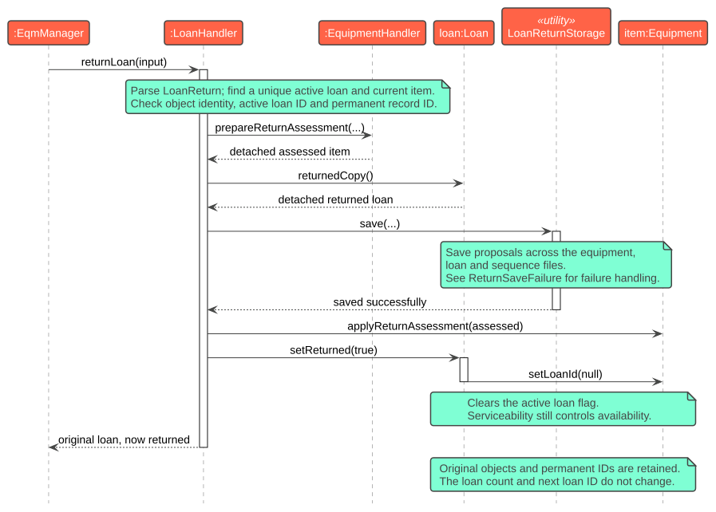
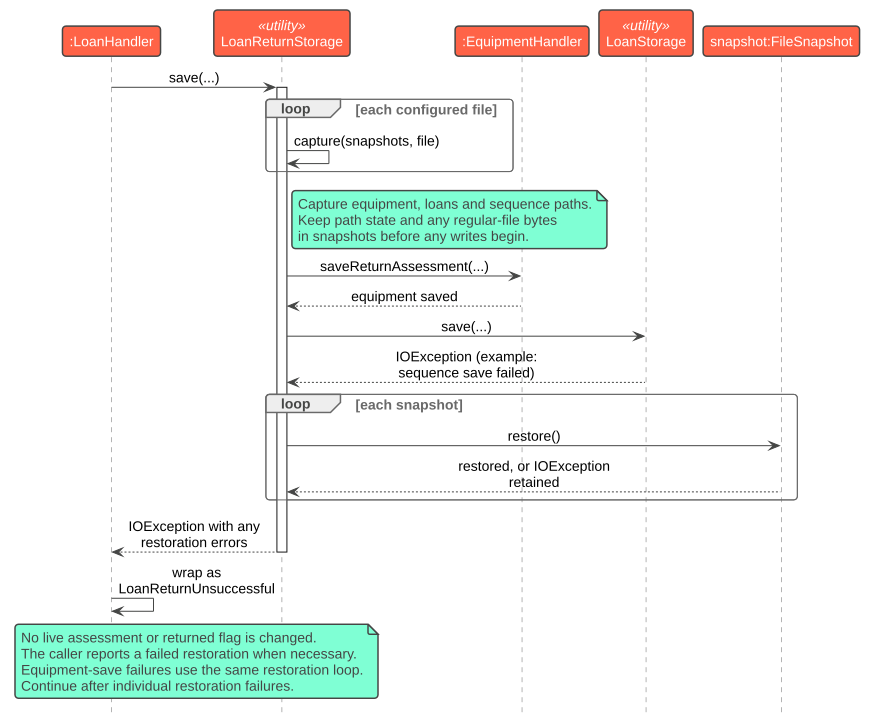
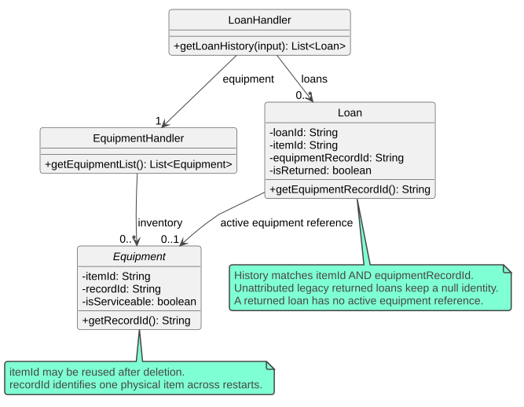
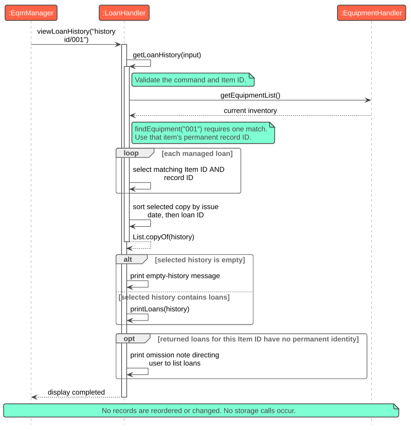
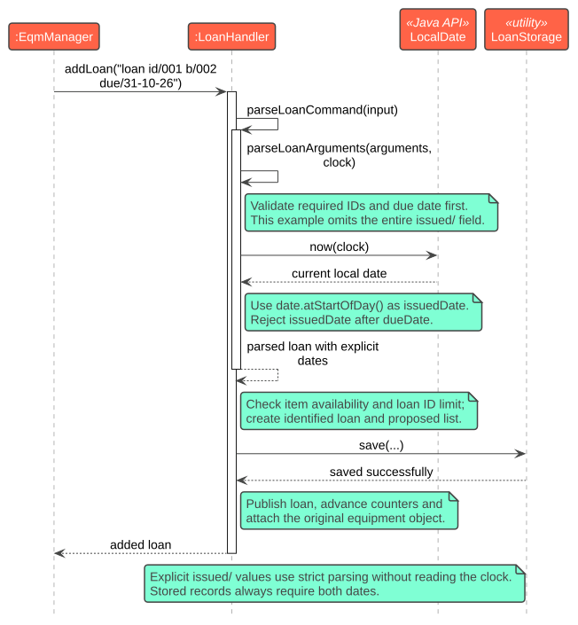
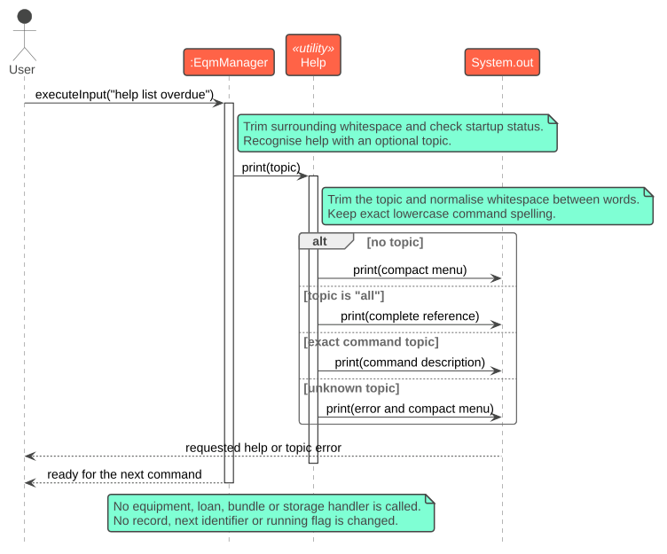

# Developer Guide

## Acknowledgements

{list here sources of all reused/adapted ideas, code, documentation, and third-party libraries -- include links to the original source as well}

## Design & implementation

The following sections describe the implemented return ([#78](https://github.com/AY2627S1-CS2113-W13-1/tp/issues/78)),
item history ([#53](https://github.com/AY2627S1-CS2113-W13-1/tp/issues/53)), optional fields
([#55](https://github.com/AY2627S1-CS2113-W13-1/tp/issues/55)), help
([#56](https://github.com/AY2627S1-CS2113-W13-1/tp/issues/56)) and equipment compatibility
([#61](https://github.com/AY2627S1-CS2113-W13-1/tp/issues/61)) enhancements.
`EqmManager` routes commands and displays outcomes; handlers validate requests against current records;
model objects hold equipment and loan state; storage utilities read and write files.

The diagrams show only interactions needed to explain each design. `...` means parameters are omitted.
Select a diagram to open its SVG at full size and zoom in to read the labels.
Notes summarise checks or local processing; messages such as selecting records describe processing rather than
additional Java methods. Lifelines with names such as `item:Equipment` represent objects; utility lifelines
represent classes with static methods. Editable PlantUML sources are linked below each figure.

### Equipment compatibility attributes

#### Purpose and representation

Different equipment subtypes require different information when deciding whether they can be used together.
The model therefore stores compatibility information on the subtype that owns it instead of adding unrelated
fields to the base `Equipment` class.

| Equipment subtype | Compatibility attributes |
| --- | --- |
| `Camera` | Lens mount, tripod thread and battery type |
| `Lens` | Lens mount and supported sensor format |
| `Battery` | Battery type |
| `Tripod` | Tripod thread |

The existing subtype detail remains separate from these attributes. For example, a camera retains its sensor
format while also storing its mount, tripod thread and battery type. Every compatibility value is normalised
through `CompatibilityText`. Leading and trailing Unicode whitespace is removed, values must contain between
1 and 100 characters, and omitted values use the shared `unspecified` representation.

`EquipmentDetailField` defines the supported command markers. `EquipmentDetailParser` scans the optional fields,
rejects repeated, reordered or inapplicable markers, and returns the values supplied by the user.
The subtype-specific parsers then construct `Camera`, `Lens`, `Battery` or `Tripod` objects.
`EquipmentDetailFormatter` generates the same ordered representation for listing and persistence.

#### Compatibility comparison

`EquipmentCompatibility.compare(first, second)` provides an internal API for bundle and other follow-up
features. This version does not expose a separate command that prints compatibility results.
Comparison works in either argument order and follows these relationships:

1. A camera and lens compare their lens mounts and sensor formats.
2. A camera and battery compare their battery types.
3. A camera and tripod compare their tripod threads.
4. Other equipment pairs return `NOT_APPLICABLE`.

Known matching values produce `COMPATIBLE`. A known mismatch produces `INCOMPATIBLE`.
If a required value is `unspecified`, the result is `UNKNOWN`. For camera-and-lens comparison, a known mismatch
takes precedence over an unknown value; the pair cannot be compatible when one known attribute conflicts.
Comparisons ignore letter case because compatibility identifiers may be entered with different capitalisation.

#### Preservation and persistence

Compatibility attributes form part of each subtype's normal equipment details. `EquipmentStorage` therefore
saves them using the same command-style record used for the other subtype fields. Loading reconstructs the
correct subclass and restores every supplied attribute. Older records remain valid because omitted compatibility
fields default to `unspecified`.

Equipment name and condition updates recreate a proposed record from `getDetails()`, so compatibility values
survive validation, saving and restart. Return assessments also copy every compatibility attribute into the
detached proposal before saving. Applying an assessment changes damage, remarks and serviceability without
discarding the equipment information needed by later bundle checks.

#### Design choices and verification

Storing the fields directly on their relevant subclasses keeps invalid combinations unrepresentable; for
example, a standalone battery does not acquire lens-mount data. Using a shared parser and formatter avoids
different ordering or validation rules between subtypes. A three-state applicable result distinguishes missing
information from a confirmed mismatch, while `NOT_APPLICABLE` distinguishes unrelated equipment types.

`EquipmentCompatibilityTest` covers matching, conflicting, unknown and unrelated pairs, reversed arguments,
precedence rules and comparisons after persistence reload. Subtype parser and integration tests cover optional,
repeated, reordered and inapplicable fields, Unicode whitespace, listing, updating and legacy saved records.
`EquipmentReturnAssessmentTest` verifies that compatibility attributes survive assessment preparation,
application, saving and restart.

### Returning equipment with an assessment

#### Purpose and responsibilities

A return must end the active loan while retaining the original borrowing record.
It must also record whether the item can be used again. For example,
`return loan/001 serviceable/no damage/SENSOR_DAMAGE remarks/Needs repair` retains loan `001` as returned
and records an unserviceable camera. Deleting that loan instead would lose its borrowing history.

| Class | Responsibility in a return |
| --- | --- |
| `EqmManager` | Routes the command and displays success or `LoanReturnUnsuccessful`. |
| `LoanReturn` | Parses the ordered assessment fields into a record without changing equipment. |
| `LoanHandler` | Checks the loan and its ownership, prepares proposals, requests saving, then changes the original objects. |
| `EquipmentHandler` | Validates subtype-specific damage and prepares and saves the proposed equipment assessment. |
| `LoanReturnStorage` | Captures the configured files, saves both proposals and attempts restoration after a write failure. |
| `Equipment` and `Loan` | Apply the saved assessment and permanent returned state while preserving their identities. |

#### Successful return

The sequence below assumes an active loan `001` and an assessment valid for its equipment subtype.
Parsing and repeated inventory checks are summarised in the first note to keep attention on the order of saving
and changing records.

[](images/ReturnSequence.svg)

*Figure 1. A successful return changes the original records only after saving succeeds.*
[PlantUML source](diagrams/ReturnSequence.puml)

1. `LoanReturn.parse(...)` requires a Loan ID from `001` to `999`, an explicit serviceability decision and
   a damage value. Final `remarks/` is optional unless damage is `OTHER`, which requires non-empty text.
   Supplied remarks must be one line of at most 200 characters after trimming; final text remains literal.
2. `LoanHandler.findLoanForReturn(...)` requires exactly one active loan. The handler finds the current equipment
   and calls `Loan.ownsEquipment(...)`, checking the object reference, active loan ID and permanent equipment
   record ID. It also rejects another active loan for the same Item ID. These checks prevent a stale association
   from assessing or releasing replacement equipment.
3. `EquipmentHandler.prepareReturnAssessment(...)` validates damage against the equipment subtype and rejects
   `OTHER` when the trimmed remarks are empty. It creates a detached proposal preserving the name, Item ID,
   permanent record ID, numeric condition and subtype attributes.
   `Loan.returnedCopy()` creates a detached returned loan with the same loan ID, equipment identity, borrower
   and dates. The proposals do not change either live object.
4. `LoanReturnStorage.save(...)` saves a proposed inventory containing the assessment and a proposed loan list
   containing the returned copy. The next loan number is saved without being incremented.
5. After saving succeeds, `Equipment.applyReturnAssessment(...)` changes the original item and
   `Loan.setReturned(true)` changes the original loan. The latter detaches its active equipment reference and
   clears the item's loan ID and loaned flag. The loan remains in the list; its count and next ID are unchanged.

The original equipment object is retained because bundles and active loan associations use object references.
Replacing the inventory entry alone could leave a bundle pointing to old details. Returning a loan is permanent:
it cannot be returned twice or reactivated. Later borrowing creates a new loan with a new ID.

Serviceability is separate from the loaned flag. An unserviceable returned item has no active loan, but new loans,
new bundle additions and `status/available` filtering reject it. Listing displays `Unserviceable`.
Normal name and numeric-condition updates retain the assessment. There is no repair command in this feature.
Storage prefixes each add record with `recordId/UUID`, then `serviceable/yes|no`, separated by tabs.
This keeps metadata separate from free-form names, subtype attributes and remarks. Legacy equipment without an
assessment defaults to serviceable.

#### Save failures and recovery

The next diagram expands the storage step in Figure 1. It shows a loan or sequence save failing after the
equipment proposal was written. An equipment-save failure enters the same restoration loop. Only configured
files are captured. A snapshot records regular-file bytes, absence or a pre-existing non-regular path.

[](images/ReturnSaveFailure.svg)

*Figure 2. A reported write failure triggers restoration before the return is rejected.*
[PlantUML source](diagrams/ReturnSaveFailure.puml)

All snapshots are captured before any return writes begin. If capture itself fails, no proposed records are
written. On a write failure, `LoanReturnStorage` attempts each restoration independently, even if an earlier
restoration also fails. Restoration errors are attached to the original exception. `LoanHandler` reports them
in `LoanReturnUnsuccessful` and leaves the live equipment, active loan and counters unchanged. The user must
check saved files if restoration also failed; the application does not report a successful return.

Snapshots handle reported I/O failures, but do not provide recovery after abrupt process termination or power
loss between file replacements. That would need a persistent transaction journal or transactional database.

#### Design choices and alternatives

| Decision | Reason and alternative considered |
| --- | --- |
| Retain the loan and mark it returned | Deleting the loan would discard the borrowing record needed by history. |
| Prepare detached proposals and save before changing records | Changing live objects first would need reversal after a failed save. In particular, a returned loan cannot be reactivated. |
| Apply the saved result to the original objects | Replacing objects would require updating every bundle and loan reference. |
| Record serviceability separately | Deriving it from `isLoaned` or numeric condition would treat some returned damaged items as available without an explicit assessment. |
| Snapshot files for a multi-file return | Independent writes could leave equipment and loans inconsistent after a reported failure. A journal would also cover crash recovery, but adds a separate recovery mechanism. |

#### Verification

`LoanReturnTest`, `EquipmentReturnAssessmentTest` and `EquipmentReturnIntegrationTest` cover valid assessments
for each subtype, `OTHER` with and without remarks, required fields, permanent returned state, stale ownership,
unchanged bundle references and serviceability restrictions. Persistence tests verify damage, remarks and
serviceability after restart. Failure tests block equipment, loan and sequence saves, and check that records
and previous files remain unchanged where restoration is possible before retrying successfully.

### Viewing the history of a physical equipment item

#### Permanent identity

`history id/001` displays active and returned loans for the physical item currently registered as `001`.
The three-digit Item ID can be reused after deletion. Matching only that value would mix the old and replacement
items' histories, even if the replacement has the same name and type.

Each new `Equipment` receives a UUID stored as the `recordId` string. A loan created from that equipment copies
it into `equipmentRecordId`. These stored values survive restarts. The class diagram shows the distinction
between that permanent identity and an active object reference; unrelated fields, subclasses and storage classes
are omitted.

[](images/EquipmentIdentity.svg)

*Figure 3. History uses stored identity values, while an active loan also refers to an equipment object.*
[PlantUML source](diagrams/EquipmentIdentity.puml)

`LoanHandler` selects a record only when **both** its Item ID and permanent equipment ID match the current item.
A replacement receives a fresh UUID even if all user-visible details are identical. Return and update proposals
preserve the original UUID. A returned loan keeps its identity string after its active object reference is cleared.

Equipment storage writes `recordId/UUID` before serviceability and the add record, with tab delimiters.
Loan storage appends `equipment/UUID` after its returned flag. Both loaders validate UUID syntax;
`EquipmentStorage` also rejects duplicate equipment record IDs before publishing the inventory. Multiple loans
may intentionally share an equipment identity. An active loan whose explicit identity does not match the current
item is rejected.

#### Query sequence

The following sequence assumes Item ID `001` exists uniquely. Invalid syntax, a missing item or an ambiguous
Item ID produces `LoanHistoryUnsuccessful` before selection.

[](images/HistorySequence.svg)

*Figure 4. A history query sorts a selected copy and leaves the managed records unchanged.*
[PlantUML source](diagrams/HistorySequence.puml)

`getLoanHistory(...)` sorts the selected copy by issue date and then numeric loan ID, returning `List.copyOf(...)`.
`viewLoanHistory(...)` uses the shared loan table or prints a clear empty-history message. Sorting the main loan
list instead would change the order used by later `list loans` requests. The query performs no storage operations.

#### Loading older records

Older equipment files lack permanent IDs. The parser assigns UUIDs to proposed records, then validates the
complete file. The migration must be saved successfully before the loaded inventory replaces the current objects.
Later loads do not rewrite files that already contain identities. If equipment migration succeeds but loan
migration fails, a retry reuses the saved equipment IDs rather than generating another set.

An active legacy loan can be associated with the current item because equipment cannot be deleted while it has
an active loan. The loader binds its proposed record to the current UUID and saves the migration before changing
the live loan list, counters, equipment flags or associations.

Returned legacy loans cannot be associated safely because their Item IDs may already have been reused.
They retain a null identity across saves and loads and remain visible in `list loans`. Item-specific history
excludes them and prints an omission note when relevant. This preserves the evidence available in the old data
without guessing which physical item was borrowed.

#### Design choices and alternatives

| Decision | Reason and alternative considered |
| --- | --- |
| Store a UUID separately from the Item ID | Item IDs are reusable. Combining an ID with a name or type still fails for an identical replacement. |
| Persist identity values in equipment and loans | Java object references change after restart and cannot link saved historical records on their own. |
| Leave uncertain returned legacy loans unattributed | Assigning them to today's item would create false borrowing history. They remain accessible in the full loan list. |
| Return an unmodifiable sorted copy | Sorting or exposing the managed list would allow a display request or caller to reorder the application's records. |

#### Verification

`EquipmentLoanHistoryTest` and `EquipmentLoanHistoryIntegrationTest` exercise same-name and different-type
replacement items, Item ID reuse across restarts, preserved identities through updates and returns, chronological
ordering, empty histories and read-only queries. Storage tests also reject malformed or duplicate identities and
check that failed migrations do not publish partial in-memory state. A retry must retain any identities already
saved by a successful equipment migration.

### Optional command fields and explicit defaults

#### Rules and responsibilities

Optional fields shorten commands while preserving validation. Defaults apply only when the whole field is absent;
an invalid supplied value is rejected so that a typing mistake does not silently change its meaning.

| Command or field | Behaviour when omitted |
| --- | --- |
| Equipment subtype detail | `unspecified` |
| Equipment `damage/` | `NONE` |
| Equipment `remarks/` | Empty text; rejected with `OTHER` damage |
| Loan `issued/` | Today's date in the application's local time zone, at midnight |
| Return `remarks/` | Empty text, replacing previous remarks; rejected with `OTHER` damage |
| An update field | Keep its current value |
| A filter criterion | Impose no restriction for that criterion |

Equipment addition supplies its defaults through `EquipmentHandler`. Optional details and damage use the same
Unicode whitespace trimming as common fields; a supplied whitespace-only detail is rejected.
`LoanReturn.parse(...)` supplies omitted final remarks as an empty string through the existing assessment and
save-before-change path. An explicitly empty remark has the same meaning. Loan ID, serviceability and damage
remain mandatory, so the application cannot assume that a return assessment was performed.

#### Default issue-date sequence

For this example, assume the application's local date is 24 October 2026 and the equipment is available.
`loan id/001 b/002 due/31-10-26` stores 24 October 2026 at midnight as its issue date.
The diagram omits model construction and ordinary availability checks to focus on when the default is chosen.

[](images/LoanDateDefault.svg)

*Figure 5. The optional date is resolved during command parsing and stored as an ordinary explicit date.*
[PlantUML source](diagrams/LoanDateDefault.puml)

`LoanHandler.parseLoanCommand(...)` accepts four or five arguments and delegates to `parseLoanArguments(...)`.
For the four-argument form, the shared validator checks the IDs and required due date, then reads
`LocalDate.now(clock)` once and calls `atStartOfDay()`. It rejects an issue date after the due date before saving
or consuming a loan ID. The five-argument form strictly parses the supplied issue date without reading the clock.

The `Clock` is supplied through constructors, with existing constructors using the system's local time zone.
Tests can supply a fixed clock and check date boundaries without changing the computer's date. Reading once
also prevents one command from obtaining inconsistent defaults if the clock crosses midnight.

`parseLoanRecord(...)` is a separate entry point requiring both dates explicitly, while sharing value validation
with commands. Restart loading never replaces a missing or invalid historical date with today's date.

#### Design choices and alternatives

Keeping `due/` mandatory leaves the intended loan duration to the user. Inventing a default duration would require
an additional rule that has not been specified. Defaulting empty or invalid `issued/` values was also rejected
because it would hide input errors. A supplied `Clock` is preferable to direct system-date calls because local
dates and midnight boundaries can be tested consistently.

Using the permissive command parser for storage would make the meaning of an incomplete saved record depend on
when it was loaded. The separate strict entry point prevents that. Similarly, omitted return remarks clear the
previous assessment's notes; retaining them could present an old damage note as part of the new assessment.

#### Verification

`EquipmentOptionalFieldsTest` checks every subset of optional equipment fields for all four subtypes.
`LoanOptionalFieldsTest` checks fixed local dates, explicit dates, time zones, one clock read at midnight, invalid
supplied values and strict stored records. `OptionalFieldsIntegrationTest` checks persistence, omitted and empty
return remarks, required assessments, and failed saves followed by successful retries.

### Showing command help without changing records

#### Implementation and sequence

`help` displays all 17 supported command formats and examples, required and optional fields, defaults and
restrictions. The welcome message and unknown-command error direct users to it. `EqmManager.executeInput(...)`
recognises the exact command after trimming surrounding whitespace; `help add` follows the unknown-command path.
The existing startup-error check remains first: the input loop stops if saved data cannot be loaded.

[](images/HelpSequence.svg)

*Figure 6. Help prints a reference and returns control to the command loop.*
[PlantUML source](diagrams/HelpSequence.puml)

`Help` is a utility class containing a fixed reference built once as `TEXT`. It uses immutable equipment limits
and damage enums when constructing the text, so those values come from the model. `Help.print()` only calls
`System.out.print(TEXT)`. It has no equipment, loan or bundle handler references and performs no storage operations.
Consequently, requesting help does not consume identifiers, save files, alter records or end the session.

#### Design choices and alternatives

A fixed reference is sufficient for one no-argument help command. Per-command help would need additional command
syntax, while generating descriptions by reflection would need metadata that the handlers do not currently
provide. Both add work beyond the present requirement. Reading constants and enum values reduces duplicated
limits, but command syntax and explanatory prose still need to be updated when supported behaviour changes.

Printing independently of handlers also means help does not require a writeable data directory after successful
startup. Calling save methods from a general command-completion path would make this read-only request depend
on storage and could change files unnecessarily.

#### Verification

`HelpTest` checks formats and examples for every command, defaults, limits, subtype damage values and output
line endings. `HelpIntegrationTest` compares record contents, object references, permanent IDs, assessments,
counts, next identifiers, bundle completion, file bytes and modification times before and after repeated requests.
It also checks missing and blocked storage paths, surrounding Unicode whitespace, invalid help topics, continued
commands and the interactive help-then-exit loop. Invalid saved data still causes the existing startup abort.

### Preserving equipment condition when a loan is issued

#### Purpose and responsibilities

Each new loan preserves the condition of its equipment at the moment the loan is issued. This historical snapshot remains unchanged if the equipment is later updated, damaged, repaired or returned.

| Class | Responsibility |
| --- | --- |
| `EquipmentConditionSnapshot` | Stores an immutable copy of the equipment type, numeric condition, damage and remarks. |
| `Loan` | Owns the optional issue-time snapshot and preserves it when a returned copy is created. |
| `LoanHandler` | Creates loans from available equipment and displays a snapshot for `view loan/[LOAN ID]`. |
| `EqmManager` | Routes the view command and displays validation errors without changing records. |
| `EquipmentConditionSnapshotCodec` | Converts snapshots between model values and their saved representation. |
| `LoanStorage` | Saves and restores optional snapshots while continuing to accept legacy loan records. |

#### Capture and query flow

When a valid loan is created from an equipment object, `EquipmentConditionSnapshot.fromEquipment(...)` copies the relevant condition fields into a separate immutable value object. The loan stores this snapshot together with its identifiers, borrower and dates.

The snapshot contains copied values rather than a reference to the equipment. Consequently, a later return assessment or equipment update cannot rewrite historical issue-time information. `Loan.returnedCopy()` carries the same snapshot into the returned record.

For `view loan/001`, `EqmManager` delegates to `LoanHandler.viewLoanIssueCondition(...)`. The handler validates the exact three-digit loan ID, finds one matching loan and prints the recorded equipment type, condition, damage and remarks. The command performs no save and does not alter the managed loan or equipment collections.

#### Persistence and backward compatibility

`LoanStorage` delegates snapshot encoding and decoding to `EquipmentConditionSnapshotCodec`. New loan records append the snapshot data after the existing loan and equipment-identity fields. Loading reconstructs an equivalent immutable snapshot before publishing the proposed loan list.

Snapshot fields are optional for backward compatibility. A legacy record without them loads with no snapshot and remains available through the normal loan commands. Querying that record reports that its issue condition was not recorded. Incomplete or malformed snapshot metadata is rejected as damaged saved data instead of being silently replaced with current equipment information.

#### Design choices and alternatives

A copied snapshot was chosen instead of consulting the current equipment object because current condition data can change after issue. Consulting current data would incorrectly present a return assessment as the original issue condition.

The snapshot is stored inside `Loan` because it describes that specific borrowing event. Storing one historical condition in `Equipment` would not support repeated loans with different issue conditions. A dedicated value object and codec keep validation and storage conversion separate from command routing.

Legacy snapshots are left absent rather than inferred from present equipment. Inference could create false historical information, especially after equipment updates, returns or Item ID reuse.

#### Verification

`EquipmentConditionSnapshotTest` covers normalization, valid boundaries, invalid values, equality and subtype extraction. `LoanIssueConditionSnapshotTest` verifies capture, immutability and preservation through returned copies. `EquipmentConditionSnapshotCodecTest` covers valid round trips and malformed encoded values.

`LoanConditionSnapshotStorageTest` verifies direct save/load round trips, legacy records and malformed snapshot data. `LoanIssueConditionViewTest` covers handler-level output for recorded and missing snapshots, invalid and unknown loan IDs, and formatting. `LoanIssueConditionCommandTest` covers CLI routing, persistence across application restart, and that viewing leaves `equipment.txt`, `loans.txt` and `loan-sequence.txt` unchanged.

### Updating equipment details

The update feature lets an equipment officer correct an item's name or condition without
deleting the item and adding it again. The Item ID identifies the record to update and stays fixed.
Only the supplied details change; omitted details keep their existing values. The implementation
described here is provided by
[PR #59](https://github.com/AY2627S1-CS2113-W13-1/tp/pull/59).

The equipment type is fixed by its subclass. An optional `type/` field must match the current type,
ignoring case; a request to change to a different type is rejected. This keeps type-specific fields,
damage, availability, and existing loan references attached to the same object.

#### Classes involved

The feature uses the existing command handler, equipment model, and storage class. Command parsing,
validation, and saving finish before the existing equipment object is changed.

| Class | Responsibility in an update |
| --- | --- |
| `EqmManager` | Routes the command to `EquipmentHandler` and displays the result or error message. |
| `EquipmentFields` | Extracts named fields and rejects empty, repeated, or unsupported reserved fields. |
| `EquipmentHandler` | Finds the target, fills in omitted values, validates and saves the resulting details, then changes the existing object. |
| `Equipment` | Stores the item's identity and applies the validated name and condition together, preserving its subclass and other state. |
| `EquipmentStorage` | Writes the proposed inventory to the backing file when storage is configured. |

`EquipmentHandler` owns the inventory. `EquipmentFields` is a utility class with static parsing
methods; it does not store equipment. Keeping these responsibilities separate lets the handler
check the command against the inventory while the parser deals with field syntax.

`EquipmentFields.parse(...)` and `EquipmentStorage.save(...)` are static, package-private
operations. Neither helper needs an object to be created for an update.

<!-- Add class diagram here: EqmManager uses EquipmentHandler; EquipmentHandler holds Equipment
     objects and uses EquipmentFields and EquipmentStorage. Show only the update-related methods. -->

#### Update flow

Suppose Item ID `001` belongs to an equipment object named `Camera`, with type `camera` and
condition `1`. The command `update id/001 i/Film Camera cond/5` changes its name and condition
while keeping its type.

1. `EqmManager.executeInput(...)` recognises the update command and calls
   `EquipmentHandler.updateEquipment(...)`.
2. The handler calls `EquipmentFields.parse(...)` to obtain a map of field names and values.
   Fields may appear in any order. Each field may occur only once, so a later value cannot
   silently replace an earlier value.
3. The handler checks that an Item ID and at least one editable field were supplied.
   `findEquipmentForUpdate(...)` then searches the inventory for exactly one matching item.
4. The handler prepares the complete set of replacement details. In this example, it takes
   `Film Camera` and `5` from the command and keeps `camera` from the target object.
   `validateEquipmentDetails(...)` checks these values before any assignment occurs.
5. `saveUpdate(...)` creates a copy of the inventory list and replaces the target's entry in
   that copy with an object of the same equipment subclass. The existing creation method,
   `createValidatedEquipment(...)`, builds this proposed object using the new name and condition,
   the same Item ID and type, and the target's type-specific fields and damage from `getDetails()`.
   The handler saves this proposed inventory through `EquipmentStorage.save(...)` when a
   backing file is configured. The existing object and inventory remain unchanged at this stage.
6. After the save succeeds, or is skipped because no backing file is configured, the handler
   calls `Equipment.updateDetails(...)` on the existing object. The handler returns that object
   to `EqmManager`, which displays the success message.

After the command, the same object occupies the same position in the inventory. Its Item ID
remains `001`, its name is `Film Camera`, its type is `camera`, and its condition is `5`.

<!-- Add sequence diagram here for the example above. Include :EqmManager, :EquipmentHandler,
     the static EquipmentFields parser, and the target :Equipment. Show parsing, target lookup,
     validation, saveUpdate(...), EquipmentStorage.save(...), updateDetails(...), and the returned
     result. Note that a failed save leaves the existing object and inventory unchanged. -->

#### Validation and rejected commands

An update requires an Item ID from `001` to `999` and at least one of `i/`, `type/`, or `cond/`.
The name must contain 1 to 100 characters, the type must contain text, and the condition must
be a whole number from 1 to 10. Addition and updates use the same value validation method,
so an update cannot introduce details that an addition would reject.
An explicitly supplied type must match the target's type, ignoring case. A different type is
rejected before saving, even when the other supplied values are valid.

A missing target is rejected. The lookup also rejects multiple matches rather than changing
an arbitrary item if the inventory contains duplicate IDs. Empty and repeated fields are
rejected during parsing, before the handler attempts to modify an item.

For example, `update id/001 i/Film Camera cond/11` must leave both the original name and
condition unchanged. The handler first validates every proposed value, then saves the proposed
inventory before calling `updateDetails(...)`. A rejected command becomes an
`EquipmentUpdateUnsuccessful` exception, whose message is displayed by `EqmManager`.
The application can then accept another command.

If saving throws an `IOException`, `saveUpdate(...)` wraps it in an
`EquipmentUpdateUnsuccessful` exception with a message beginning `Could not save equipment update:`.
The handler does not call `updateDetails(...)`, so the original object's name, type, condition,
and Item ID remain unchanged. The inventory keeps the same objects in the same order.
`EqmManager` displays the error instead of a success message, and the application can accept
another command.

#### Design decisions

The Item ID is fixed because other records use it to identify the equipment. Changing details
should not change which item those records refer to. Updating the existing object also
preserves references held by active loans and the item's availability. Only the proposed list used
for saving contains a new object; the inventory retains the original object after a successful save.
Changing type is rejected because types are represented by different subclasses. Replacing the
inventory object with another subclass would require rules for converting its specific fields and
damage, and updating every existing loan reference. Keeping the current type avoids those changes.

Keeping omitted fields makes small corrections convenient. Requiring every field again would
make the command longer and give users more opportunities to overwrite correct details.
At least one editable field is still required, so a command containing only an ID is rejected.

User input is checked with exceptions, which work whether Java assertions are enabled or
disabled. Assertions inside the model and handler check programming assumptions, including
valid internal values, an unchanged Item ID, and an unchanged inventory size. Diagnostic
logging records accepted and rejected updates at `FINE` level.

#### Testing the feature

`EquipmentUpdateTest` covers partial updates, multiple supplied fields, valid boundaries,
malformed commands, and missing or ambiguous IDs. Rejection tests check that every original
field and the inventory order remain unchanged, including when one supplied value is valid
and another is invalid. Successful updates are checked for object identity as well as values.
Command-level tests also check that a valid update succeeds after a rejected command.

`EquipmentUpdatePersistenceTest` checks that a restart restores the updated details while
retaining omitted fields. It also checks that rejected values preserve the saved file,
a failed write preserves the original object and inventory order, and an update succeeds
after the storage problem is fixed.

### Overdue loan identification

#### Overview

The overdue-loan feature allows equipment managers to identify active loans whose due dates have passed. Users access the feature with the `list overdue` command. The command displays the item ID, borrower ID, and due date of every overdue loan. If there are no overdue loans, the application displays a clear message instead of an empty table.

A loan is overdue only when both conditions are satisfied:

1. The loan has not been returned.
2. Its due date is earlier than the current local date.

The comparison is date-based because loan commands accept dates in `DD-MM-YY` format without a specific time. A loan due today is therefore not overdue, even if its stored due time is earlier than the current time. It becomes overdue on the following day if it has not been returned.

Listing overdue loans is read-only. It does not add, remove, return, or otherwise modify any loan record.

#### Component responsibilities

`EqmManager` recognises the exact `list overdue` command. It obtains the current date once from its configured `Clock` and delegates the request to `LoanHandler`. Reading the date once ensures that every loan in the same command is evaluated consistently and allows tests to use a fixed date.

`LoanHandler.getOverdueLoans(referenceDate)` examines the stored loans in their existing order. It selects loans for which `Loan.isOverdue(referenceDate)` returns `true` and returns an unmodifiable result list. `LoanHandler.viewOverdueLoans(referenceDate)` formats the matching loans and displays a clear message when none are found.

`Loan.isOverdue(referenceDate)` owns the overdue-status rule because the loan contains the required due date and returned status. The condition is:

```text
not returned AND due date is before reference date
```

The reference date is supplied to the method instead of being obtained directly from the system clock. This keeps the model behaviour deterministic and independently testable.

#### Command execution

When the user enters `list overdue`, `EqmManager` obtains the current local date using its configured `Clock` and passes that date to `LoanHandler`.

`LoanHandler` evaluates every stored loan using `Loan.isOverdue(referenceDate)`. Returned loans are excluded even when their due dates are in the past. Active loans due today or in the future are also excluded. Matching loans retain their existing order and are displayed using the following columns:

```text
No.  ITEM ID      | BORROWER ID  | DUE DATE
```

If no loans match, the application displays:

```text
No overdue loans found.
```

The handler records the number of matching loans through diagnostic logging, including the valid zero-result case.

#### Defensive behaviour

The reference date must not be `null`. A null reference date represents a programming error because users do not provide it directly. `Loan.isOverdue(...)` and `LoanHandler.getOverdueLoans(...)` therefore reject it with a `NullPointerException`.

`LoanHandler` also asserts that its stored loan count matches the collection size and that the collection contains no null loan entries. These assertions detect corrupted internal state with clear development-time messages.

The returned overdue-loan list is unmodifiable. Callers therefore cannot use the result to alter or reorder the managed loan collection.

#### Design alternatives

One alternative was to store an `isOverdue` Boolean field in each `Loan`. This was rejected because overdue status changes as time passes. A stored value could become outdated unless every loan were updated regularly. Deriving the value from the due date and reference date keeps it current.

Another alternative was to place the complete overdue condition inside `LoanHandler`. This was rejected because it would separate loan-related behaviour from the object containing the relevant state. Keeping `isOverdue(...)` in `Loan` also allows the rule to be tested independently.

A third alternative was to compare complete `LocalDateTime` values. This was rejected because users provide due dates without specific times. Date-time comparison could mark a loan due today as overdue during that same day. Comparing only dates matches the user-facing command format.

#### Verification

`LoanTest` covers active loans with past, current, and future due dates; loans due at different times on the reference date; returned loans; and null reference dates.

`LoanHandlerTest` covers mixed loan collections, preserved ordering, unmodifiable results, null entries, empty results, formatted output, diagnostic logging, and unchanged managed records.

`EqmManagerTest` verifies command routing using a fixed `Clock`. It also confirms that `list overdue` does not modify equipment availability, loan records, or persisted files.

## Product scope
### Target user profile

{Describe the target user profile}

### Value proposition

{Describe the value proposition: what problem does it solve?}

## User Stories

|Version| As a ... | I want to ... | So that I can ...|
|--------|----------|---------------|------------------|
|v1.0|new user|see usage instructions|refer to them when I forget how to use the application|
|v2.0|user|find a to-do item by name|locate a to-do without having to go through the entire list|

## Non-Functional Requirements

{Give non-functional requirements}

## Glossary

* *glossary item* - Definition

## Instructions for manual testing

{Give instructions on how to do a manual product testing e.g., how to load sample data to be used for testing}
