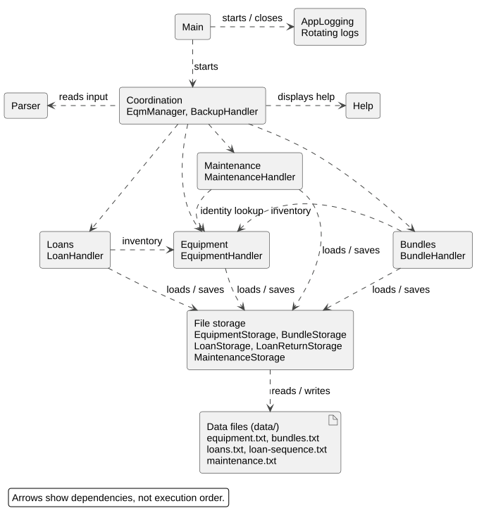
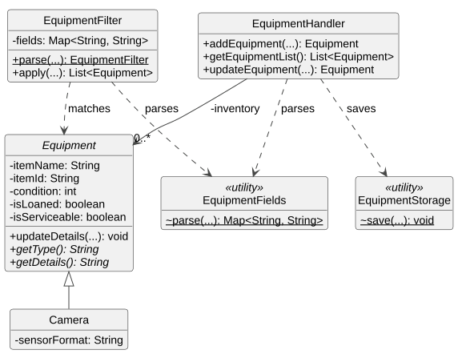
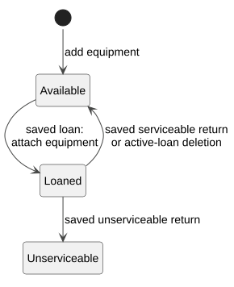
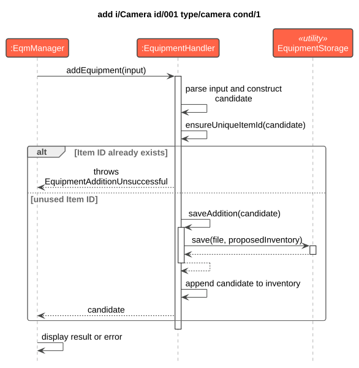
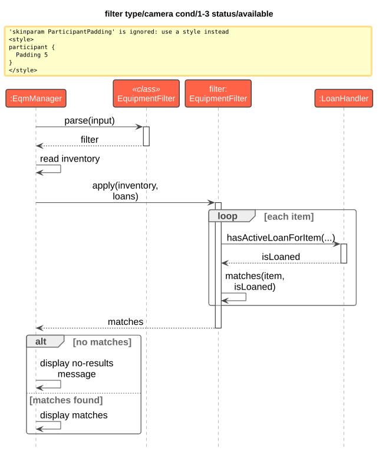
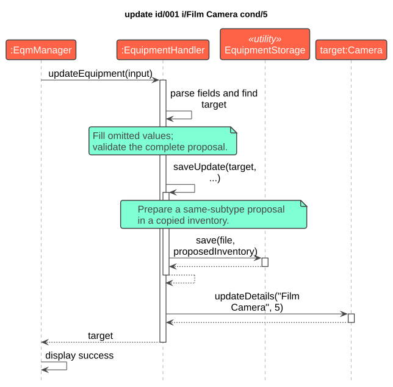
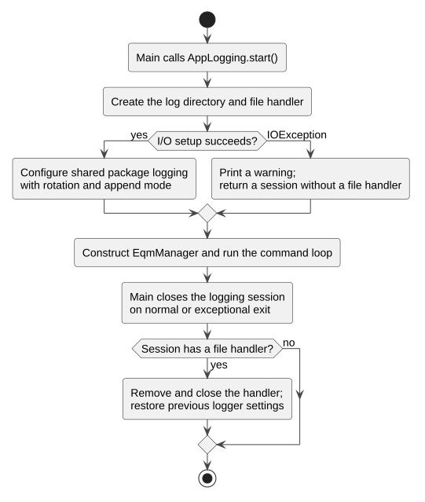

# Developer Guide

## Acknowledgements

- The project started from the [CS2113 team-project template](https://github.com/NUS-CS2113-AY2627-S1/tp).
- The organisation of this guide was informed by the [AddressBook-Level3 Developer Guide](https://se-education.org/addressbook-level3/DeveloperGuide.html).
- Diagrams are rendered with [PlantUML](https://plantuml.com/). The shared style uses the
  [vibrant theme by future-architect](https://github.com/future-architect/puml-themes), distributed with PlantUML.
- Builds use [Gradle](https://gradle.org/) and [Shadow](https://github.com/GradleUp/shadow);
  verification uses [JUnit](https://junit.org/junit5/) and [Checkstyle](https://checkstyle.org/).
- Image and icon sources, including the snAp logo and GitHub mark, are recorded in
  [asset sources](assets/SOURCES.txt) with the accompanying icon licence.

**Version:** This guide describes the development implementation on `master`.
The latest published release is [v1.0](https://github.com/AY2627S1-CS2113-W13-1/tp/releases/tag/v1.0),
whose [versioned source](https://github.com/AY2627S1-CS2113-W13-1/tp/tree/v1.0) contains the original equipment
and loan commands. The architecture and enhancement sections below describe work for the next release;
they are not a description of the v1.0 JAR.

<a id="design--implementation"></a>

## Design

The following sections explain the architecture and implementation of equipment management, loans,
returns, history, maintenance, optional fields, help, backup and restore, and shared logging.

Diagrams omit minor helpers and repetitive calls; `...` omits parameters. Named and unnamed object lifelines
use `item:Equipment` and `:Equipment` notation. Class and utility lifelines receive static calls.
Action labels such as `display success` summarise local processing rather than additional Java methods.
Select an SVG to view it at full size; editable PlantUML sources are linked below each figure.

### Application architecture

The architecture diagram groups related classes into feature areas. Arrows show dependencies;
the feature sequence diagrams illustrate execution order for individual commands.

[](images/AppArchitecture.svg)

*Figure 1. Application architecture and dependencies between feature areas.*

[PlantUML source](diagrams/AppArchitecture.puml)

| Part | Main classes | Responsibility |
| --- | --- | --- |
| Startup and logging | `Main`, `AppLogging` | Starts the command loop and shared rotating logs; closes logging when the application ends. |
| Coordination | `EqmManager`, `BackupHandler` | Creates handlers, routes commands and coordinates backup and restoration. |
| Input | `Parser` | Reads one command line from the console. Feature parsers interpret its fields. |
| Help | `Help` | Prints the command reference. |
| Equipment | `EquipmentHandler`, `EquipmentFilter`, `Equipment` and its subclasses | Manages the inventory, filtering, updates and subtype details. |
| Loans | `LoanHandler`, `Loan` | Manages borrowing, returns, history and overdue queries. |
| Bundles | `BundleHandler`, `Bundle` | Manages reusable equipment groups and restores their memberships between sessions. |
| Maintenance | `MaintenanceHandler`, `MaintenanceRecord` | Validates and records completed maintenance against a physical equipment identity. |
| File storage | `EquipmentStorage`, `BundleStorage`, `LoanStorage`, `LoanReturnStorage`, `MaintenanceStorage` | Loads and saves records, including coordinated return and maintenance saves. |

Both `LoanHandler` and `BundleHandler` use the same `EquipmentHandler` created by `EqmManager`.
They therefore work with the current equipment objects and availability. For example, updating an item's
name changes the item seen by an existing loan or bundle without replacing its equipment reference.

The file-storage box groups the existing utilities. Default paths are `data/equipment.txt`,
`data/bundles.txt`, `data/loans.txt`, `data/loan-sequence.txt` and `data/maintenance.txt`. The backup format
contains the equipment, loan and sequence files plus a checksum manifest; bundle and maintenance files are not part
of the backup format. The [logging section](#shared-logging-and-equipment-assertions) explains the shared file
handler and cleanup.

Build and run with Java 25. Gradle starts `seedu.snap.Main`; `shadowJar` produces
`build/libs/snAp.jar`. The `run` and `test` tasks enable assertions. For the packaged JAR,
`java -ea -jar build/libs/snAp.jar` enables the same development checks; normal command validation
uses exceptions and remains active without `-ea`.

The [shared equipment model](#shared-equipment-model) gives the class-level view.
The implementation sections explain the command flows and the reasons for their validation and save ordering.

## Implementation

### Shared equipment model

Equipment addition, filtering, updates, loans and bundles use the same inventory. `EquipmentHandler` owns its
ordered equipment objects; loans and bundles retain references to those objects so they observe the same details
and availability. `getEquipmentList()` provides an unmodifiable view for queries and display, while additions and
updates go through validation and persistence.

[](images/EquipmentClasses.svg)

*Figure 2. Equipment classes and their roles in inventory management.*

[PlantUML source](diagrams/EquipmentClasses.puml)

`Equipment` holds common identity, name, condition and availability state. `Camera` represents one concrete
subtype; `Lens`, `Battery` and `Tripod` use the same inheritance relationship. `EquipmentFields` parses filter
and update fields, `EquipmentStorage` handles file access, and the add command uses its own ordered parser.

Solid arrows show stored references; dashed arrows show dependencies. `+`, `-` and `~` mean public, private and
package-private; underlined operations are static and italic names are abstract. Minor fields, getters and the
loan/bundle classes are omitted.

#### Availability and loan ownership

An active `Loan` refers to the original equipment object. The equipment records its loan ID and loaned flag together
through `setLoanId(...)`. `LoanHandler.addLoan(...)` checks for one available, serviceable item and saves before
`Loan.attachEquipment(...)` publishes the association.

[](images/EquipmentAvailability.svg)

*Figure 3. Equipment availability changes after successful borrowing and return operations.*

[PlantUML source](diagrams/EquipmentAvailability.puml)

With no active loan, serviceability decides between `Available` and `Unserviceable`. The integrated
[return assessment](#returning-equipment-with-an-assessment) sets serviceability separately from numeric
condition and damage. Loan reassignment saves proposed records before releasing the old item and reserving the
replacement. Returns and deletions likewise save before detaching; loading rebuilds active associations from loans.

### Equipment compatibility attributes

#### Purpose and representation

Different equipment subtypes require different information when deciding whether they can be used together.
The model therefore stores compatibility information on the subtype that owns it instead of adding unrelated
fields to the base `Equipment` class.

| Equipment subtype | Compatibility attributes |
| --- | --- |
| `Camera` | Lens mount, tripod thread and battery type |
| `Lens` | Lens mount and supported sensor format |
| `Battery` | Battery type |
| `Tripod` | Tripod thread |

The existing subtype detail remains separate from these attributes. For example, a camera retains its sensor
format while also storing its mount, tripod thread and battery type. Every compatibility value is normalised
through `CompatibilityText`. Leading and trailing Unicode whitespace is removed, values must contain between
1 and 100 characters, and omitted values use the shared `unspecified` representation.

`EquipmentDetailField` defines the supported command markers. `EquipmentDetailParser` scans the optional fields,
rejects repeated, reordered or inapplicable markers, and returns the values supplied by the user.
The subtype-specific parsers then construct `Camera`, `Lens`, `Battery` or `Tripod` objects.
`EquipmentDetailFormatter` generates the ordered representation used for validation and persistence.
The equipment detail view displays the individual subtype values with readable labels.

#### Compatibility comparison

`EquipmentCompatibility.compare(first, second)` checks candidates added through `add-to-bundle` against the
existing bundle members. There is no separate command that prints compatibility results.
Comparison works in either argument order and follows these relationships:

1. A camera and lens compare their lens mounts and sensor formats.
2. A camera and battery compare their battery types.
3. A camera and tripod compare their tripod threads.
4. Other equipment pairs return `NOT_APPLICABLE`.

Known matching values produce `COMPATIBLE`. A known mismatch produces `INCOMPATIBLE`.
If a required value is `unspecified`, the result is `UNKNOWN`. For camera-and-lens comparison, a known mismatch
takes precedence over an unknown value; the pair cannot be compatible when one known attribute conflicts.
Comparisons ignore letter case because compatibility identifiers may be entered with different capitalisation.

#### Bundle compatibility validation

`BundleHandler.addItemsToBundle(...)` processes requested equipment IDs in command order and reports one result
for each ID. For every otherwise valid candidate, `findIncompatibleEquipment(...)` compares it with each item
currently in the target bundle by calling `EquipmentCompatibility.compare(...)`.

If a comparison returns `INCOMPATIBLE`, the candidate is rejected and the result identifies the first conflicting
equipment ID. Validation occurs before `Bundle.addEquipment(...)`, so the rejected candidate does not change the
bundle contents or completion state. `UNKNOWN` and `NOT_APPLICABLE` do not block addition because missing
compatibility information and unrelated equipment types do not prove that the equipment cannot be used together.

Successful additions earlier in the same command immediately become part of the bundle. They are therefore
included when later candidates are checked. An incompatible candidate does not stop the remaining IDs from being
processed, preserving the command's existing per-item result and partial-success behaviour.

Compatibility validation belongs in `BundleHandler` because that class already checks inventory availability,
duplicates and category limits and creates user-facing failure messages. `Bundle` remains responsible for storing
already-validated equipment and calculating whether its required composition is complete.

#### Preservation and persistence

Compatibility attributes form part of each subtype's normal equipment details. `EquipmentStorage` therefore
saves them using the same command-style record used for the other subtype fields. Loading reconstructs the
correct subclass and restores every supplied attribute. Older records remain valid because omitted compatibility
fields default to `unspecified`.

Equipment name and condition updates recreate a proposed record from `getDetails()`, so compatibility values
survive validation, saving and restart. Return assessments also copy every compatibility attribute into the
detached proposal before saving. Applying an assessment changes damage, remarks and serviceability without
discarding the equipment information needed by later bundle checks.

#### Design choices and verification

Storing the fields directly on their relevant subclasses keeps invalid combinations unrepresentable; for
example, a standalone battery does not acquire lens-mount data. Using a shared parser and formatter avoids
different ordering or validation rules between subtypes. A three-state applicable result distinguishes missing
information from a confirmed mismatch, while `NOT_APPLICABLE` distinguishes unrelated equipment types.

`EquipmentCompatibilityTest` covers matching, conflicting, unknown and unrelated pairs, reversed arguments,
precedence rules and comparisons after persistence reload. Subtype parser and integration tests cover optional,
repeated, reordered and inapplicable fields, Unicode whitespace, listing, updating and legacy saved records.
`EquipmentReturnAssessmentTest` verifies that compatibility attributes survive assessment preparation,
application, saving and restart.

`BundleCompatibilityTest` covers compatible camera-lens, camera-battery and camera-tripod relationships,
both camera-lens fields, reversed insertion order, candidates supplied together, missing compatibility data and
equipment pairs without a compatibility relationship. Existing bundle tests verify all previous validation rules.

### Returning equipment with an assessment

#### Purpose and responsibilities

A return must end the active loan while retaining the original borrowing record.
It must also record whether the item can be used again. For example,
`return loan/001 serviceable/no damage/SENSOR_DAMAGE remarks/Needs repair` retains loan `001` as returned
and records an unserviceable camera. Deleting that loan instead would lose its borrowing history.

| Class | Responsibility in a return |
| --- | --- |
| `EqmManager` | Routes the command and displays success or `LoanReturnUnsuccessful`. |
| `LoanReturn` | Parses the ordered assessment fields into a record without changing equipment. |
| `LoanHandler` | Checks the loan and its ownership, prepares proposals, requests saving, then changes the original objects. |
| `EquipmentHandler` | Validates subtype-specific damage and prepares and saves the proposed equipment assessment. |
| `LoanReturnStorage` | Captures the configured files, saves both proposals and attempts restoration after a write failure. |
| `Equipment` and `Loan` | Apply the saved assessment and permanent returned state while preserving their identities. |

#### Successful return

The sequence below assumes an active loan `001` and an assessment valid for its equipment subtype.
Parsing and repeated inventory checks are summarised in the first note to keep attention on the order of saving
and changing records.

[](images/ReturnSequence.svg)

*Figure 4. A successful return changes the original records only after saving succeeds.*

[PlantUML source](diagrams/ReturnSequence.puml)

1. `LoanReturn.parse(...)` requires a Loan ID from `001` to `999`, an explicit serviceability decision and
   a damage value. Final `remarks/` is optional unless damage is `OTHER`, which requires non-empty text.
   Supplied remarks must be one line of at most 200 characters after trimming; final text remains literal.
2. `LoanHandler.findLoanForReturn(...)` requires exactly one active loan. The handler finds the current equipment
   and calls `Loan.ownsEquipment(...)`, checking the object reference, active loan ID and permanent equipment
   record ID. It also rejects another active loan for the same Item ID. These checks prevent a stale association
   from assessing or releasing replacement equipment.
3. `EquipmentHandler.prepareReturnAssessment(...)` validates damage against the equipment subtype and rejects
   `OTHER` when the trimmed remarks are empty. It creates a detached proposal preserving the name, Item ID,
   permanent record ID, numeric condition and subtype attributes.
   `Loan.returnedCopy()` creates a detached returned loan with the same loan ID, equipment identity, borrower
   and dates. The proposals do not change either live object.
4. `LoanReturnStorage.save(...)` saves a proposed inventory containing the assessment and a proposed loan list
   containing the returned copy. The next loan number is saved without being incremented.
5. After saving succeeds, `Equipment.applyReturnAssessment(...)` changes the original item and
   `Loan.setReturned(true)` changes the original loan. The latter detaches its active equipment reference and
   clears the item's loan ID and loaned flag. The loan remains in the list; its count and next ID are unchanged.

The original equipment object is retained because bundles and active loan associations use object references.
Replacing the inventory entry alone could leave a bundle pointing to old details. Returning a loan is permanent:
it cannot be returned twice or reactivated. Later borrowing creates a new loan with a new ID.

Serviceability is separate from the loaned flag. An unserviceable returned item has no active loan, but new loans,
new bundle additions and `status/available` filtering reject it. Listing displays `Unserviceable`.
Normal name and numeric-condition updates retain the assessment. There is no repair command in this feature.
Storage prefixes each add record with `recordId/UUID`, then `serviceable/yes|no`, separated by tabs.
This keeps metadata separate from free-form names, subtype attributes and remarks. Legacy equipment without an
assessment defaults to serviceable.

#### Save failures and recovery

The next diagram expands the storage step in Figure 4. It shows a loan or sequence save failing after the
equipment proposal was written. An equipment-save failure enters the same restoration loop. Only configured
files are captured. A snapshot records regular-file bytes, absence or a pre-existing non-regular path.

[](images/ReturnSaveFailure.svg)

*Figure 5. A reported write failure triggers restoration before the return is rejected.*

[PlantUML source](diagrams/ReturnSaveFailure.puml)

All snapshots are captured before any return writes begin. If capture itself fails, no proposed records are
written. On a write failure, `LoanReturnStorage` attempts each restoration independently, even if an earlier
restoration also fails. Restoration errors are attached to the original exception. `LoanHandler` reports them
in `LoanReturnUnsuccessful` and leaves the live equipment, active loan and counters unchanged. The user must
check saved files if restoration also failed; the application does not report a successful return.

Snapshots handle reported I/O failures, but do not provide recovery after abrupt process termination or power
loss between file replacements. That would need a persistent transaction journal or transactional database.

#### Design choices and alternatives

| Decision | Reason and alternative considered |
| --- | --- |
| Retain the loan and mark it returned | Deleting the loan would discard the borrowing record needed by history. |
| Prepare detached proposals and save before changing records | Changing live objects first would need reversal after a failed save. In particular, a returned loan cannot be reactivated. |
| Apply the saved result to the original objects | Replacing objects would require updating every bundle and loan reference. |
| Record serviceability separately | Deriving it from `isLoaned` or numeric condition would treat some returned damaged items as available without an explicit assessment. |
| Snapshot files for a multi-file return | Independent writes could leave equipment and loans inconsistent after a reported failure. A journal would also cover crash recovery, but adds a separate recovery mechanism. |

#### Verification

`LoanReturnTest`, `EquipmentReturnAssessmentTest` and `EquipmentReturnIntegrationTest` cover valid assessments
for each subtype, `OTHER` with and without remarks, required fields, permanent returned state, stale ownership,
unchanged bundle references and serviceability restrictions. Persistence tests verify damage, remarks and
serviceability after restart. Failure tests block equipment, loan and sequence saves, and check that records
and previous files remain unchanged where restoration is possible before retrying successfully.

### Viewing the history of a physical equipment item

#### Permanent identity

`history id/001` displays active and returned loans for the physical item currently registered as `001`.
The three-digit Item ID can be reused after deletion. Matching only that value would mix the old and replacement
items' histories, even if the replacement has the same name and type.

Each new `Equipment` receives a UUID stored as the `recordId` string. A loan created from that equipment copies
it into `equipmentRecordId`. These stored values survive restarts. The class diagram shows the distinction
between that permanent identity and an active object reference; unrelated fields, subclasses and storage classes
are omitted.

[](images/EquipmentIdentity.svg)

*Figure 6. History uses stored identity values, while an active loan also refers to an equipment object.*

[PlantUML source](diagrams/EquipmentIdentity.puml)

`LoanHandler` selects a record only when **both** its Item ID and permanent equipment ID match the current item.
A replacement receives a fresh UUID even if all user-visible details are identical. Return and update proposals
preserve the original UUID. A returned loan keeps its identity string after its active object reference is cleared.

Equipment storage writes `recordId/UUID` before serviceability and the add record, with tab delimiters.
Loan storage appends `equipment/UUID` after its returned flag. Both loaders validate UUID syntax;
`EquipmentStorage` also rejects duplicate equipment record IDs before publishing the inventory. Multiple loans
may intentionally share an equipment identity. An active loan whose explicit identity does not match the current
item is rejected.

#### Query sequence

The following sequence assumes Item ID `001` exists uniquely. Invalid syntax, a missing item or an ambiguous
Item ID produces `LoanHistoryUnsuccessful` before selection.

[](images/HistorySequence.svg)

*Figure 7. A history query sorts a selected copy and leaves the managed records unchanged.*

[PlantUML source](diagrams/HistorySequence.puml)

`getLoanHistory(...)` sorts the selected copy by issue date and then numeric loan ID, returning `List.copyOf(...)`.
`viewLoanHistory(...)` uses the shared loan table or prints a clear empty-history message. Sorting the main loan
list instead would change the order used by later `list loans` requests. The query performs no storage operations.

#### Loading older records

Older equipment files lack permanent IDs. The parser assigns UUIDs to proposed records, then validates the
complete file. The migration must be saved successfully before the loaded inventory replaces the current objects.
Later loads do not rewrite files that already contain identities. If equipment migration succeeds but loan
migration fails, a retry reuses the saved equipment IDs rather than generating another set.

An active legacy loan can be associated with the current item because equipment cannot be deleted while it has
an active loan. The loader binds its proposed record to the current UUID and saves the migration before changing
the live loan list, counters, equipment flags or associations.

Returned legacy loans cannot be associated safely because their Item IDs may already have been reused.
They retain a null identity across saves and loads and remain visible in `list loans`. Item-specific history
excludes them and prints an omission note when relevant. This preserves the evidence available in the old data
without guessing which physical item was borrowed.

#### Design choices and alternatives

| Decision | Reason and alternative considered |
| --- | --- |
| Store a UUID separately from the Item ID | Item IDs are reusable. Combining an ID with a name or type still fails for an identical replacement. |
| Persist identity values in equipment and loans | Java object references change after restart and cannot link saved historical records on their own. |
| Leave uncertain returned legacy loans unattributed | Assigning them to today's item would create false borrowing history. They remain accessible in the full loan list. |
| Return an unmodifiable sorted copy | Sorting or exposing the managed list would allow a display request or caller to reorder the application's records. |

#### Verification

`EquipmentLoanHistoryTest` and `EquipmentLoanHistoryIntegrationTest` exercise same-name and different-type
replacement items, Item ID reuse across restarts, preserved identities through updates and returns, chronological
ordering, empty histories and read-only queries. Storage tests also reject malformed or duplicate identities and
check that failed migrations do not publish partial in-memory state. A retry must retain any identities already
saved by a successful equipment migration.

### Optional command fields and explicit defaults

#### Rules and responsibilities

Optional fields shorten commands while preserving validation. Defaults apply only when the whole field is absent;
an invalid supplied value is rejected so that a typing mistake does not silently change its meaning.

| Command or field | Behaviour when omitted |
| --- | --- |
| Equipment subtype detail | `unspecified` |
| Equipment `damage/` | `NONE` |
| Equipment `remarks/` | Empty text; rejected with `OTHER` damage |
| Loan `issued/` | Today's date in the application's local time zone, at midnight |
| Return `remarks/` | Empty text, replacing previous remarks; rejected with `OTHER` damage |
| An update field | Keep its current value |
| A filter criterion | Impose no restriction for that criterion |

Equipment addition supplies its defaults through `EquipmentHandler`. Optional details and damage use the same
Unicode whitespace trimming as common fields; a supplied whitespace-only detail is rejected.
`LoanReturn.parse(...)` supplies omitted final remarks as an empty string through the existing assessment and
save-before-change path. An explicitly empty remark has the same meaning. Loan ID, serviceability and damage
remain mandatory, so the application cannot assume that a return assessment was performed.

#### Default issue-date sequence

For this example, assume the application's local date is 24 October 2026 and the equipment is available.
`loan id/001 b/002 due/31-10-26` stores 24 October 2026 at midnight as its issue date.
The diagram omits model construction and ordinary availability checks to focus on when the default is chosen.

[](images/LoanDateDefault.svg)

*Figure 8. The optional date is resolved during command parsing and stored as an ordinary explicit date.*

[PlantUML source](diagrams/LoanDateDefault.puml)

`LoanHandler.parseLoanCommand(...)` accepts four or five arguments and delegates to `parseLoanArguments(...)`.
For the four-argument form, the shared validator checks the IDs and required due date, then reads
`LocalDate.now(clock)` once and calls `atStartOfDay()`. It rejects an issue date after the due date before saving
or consuming a loan ID. The five-argument form strictly parses the supplied issue date without reading the clock.

The `Clock` is supplied through constructors, with existing constructors using the system's local time zone.
Tests can supply a fixed clock and check date boundaries without changing the computer's date. Reading once
also prevents one command from obtaining inconsistent defaults if the clock crosses midnight.

`parseLoanRecord(...)` is a separate entry point requiring both dates explicitly, while sharing value validation
with commands. Restart loading never replaces a missing or invalid historical date with today's date.

#### Design choices and alternatives

Keeping `due/` mandatory leaves the intended loan duration to the user. Inventing a default duration would require
an additional rule that has not been specified. Defaulting empty or invalid `issued/` values was also rejected
because it would hide input errors. A supplied `Clock` is preferable to direct system-date calls because local
dates and midnight boundaries can be tested consistently.

Using the permissive command parser for storage would make the meaning of an incomplete saved record depend on
when it was loaded. The separate strict entry point prevents that. Similarly, omitted return remarks clear the
previous assessment's notes; retaining them could present an old damage note as part of the new assessment.

#### Verification

`EquipmentOptionalFieldsTest` checks every subset of optional equipment fields for all four subtypes.
`LoanOptionalFieldsTest` checks fixed local dates, explicit dates, time zones, one clock read at midnight, invalid
supplied values and strict stored records. `OptionalFieldsIntegrationTest` checks persistence, omitted and empty
return remarks, required assessments, and failed saves followed by successful retries.

### Formatting loan, bundle and command output

`LoanView` renders loan lists, borrower queries, overdue results, item histories and bundle histories with one set of columns,
`DD-MM-YY` dates and a result count. Handlers retain responsibility for selecting and ordering records.
The renderer receives one reference date from the handler's clock. It checks returned status first, then calls
`Loan.isOverdue(LocalDate)` to distinguish `Overdue` from `Active`. It does not store or change a loan's state.

`BundleView` displays each bundle and its members without a wide table. `Bundle.getMissingEquipmentTypes()`
uses the existing type-count rules to explain incomplete composition. This does not add compatibility or
availability validation. Persistence guidance describes the current save behaviour: new bundles and additions
are saved with `bye`, and successful removals are saved immediately.

`ConsoleOutput` prints headings and `[OK]` or `[ERROR]` labels using the welcome logo's existing colour policy.
Only headings and labels receive ANSI colour, which is reset immediately. Plain output retains the same words.
Record names have control characters escaped before display so that stored text cannot create terminal commands
or extra rows. `Parser` retains input dividers and uses the `snAp > ` prompt.

`EqmManager` reports IDs, names and resulting values after successful handler calls. Loan feedback uses permanent
equipment identity before displaying an item's current name and availability, so deleting old history cannot
describe a replacement that happens to have the same visible ID. Bundle batch methods return typed `ItemResult`
values, which distinguish successes from failures without interpreting message text. The existing string-returning
methods remain available. Removal results are returned only after saving succeeds, preserving rollback behaviour.
Backup, restore and maintenance commands use the same outcome labels. Maintenance success includes the physical
item's visible ID and name, date, work and outcome. Startup load errors continue to block ordinary commands while
allowing `restore` and `bye`; the output changes do not remove backup recovery through the interactive prompt.

`LoanViewTest`, `BundleViewTest`, `ConsoleOutputTest` and `CommandFeedbackIntegrationTest` cover date boundaries,
states, counts, control characters, plain and coloured labels, mixed batch outcomes and failed saves.
`HelpIntegrationTest` also repeats list and history commands against populated, empty and blocked storage while
checking records, object identities, counters, saved bytes and modification times remain unchanged.

### Showing command help without changing records

#### Implementation and sequence

`help` displays a compact menu grouped into Equipment, Loans, Bundles and General. `help <command>` displays
one command's format, example, fields, defaults and restrictions; `help all` displays the complete reference
for all supported commands. Topics use exact lowercase command names, including multiword names such as
`delete loan`, `view loan` and `history bundle`. Group names are menu labels, not topics. Unknown topics print
an error and the menu. `list member` is an alias for the `list borrower` topic; the menu lists the canonical name.

`EqmManager.executeInput(...)` recognises `help` followed by whitespace or the end of the input and passes the
optional topic to `Help`. `Help` trims surrounding Unicode whitespace and normalises whitespace between topic
words before lookup. This does not make other command names or fields case-insensitive. If saved data fails to load,
`EqmManager` accepts only `restore` and `bye`; help requests report the loading error until restoration succeeds.

[](images/HelpSequence.svg)

*Figure 9. Help selects the requested text and returns control to the command loop.*

[PlantUML source](diagrams/HelpSequence.puml)

`Help` is a utility class containing an immutable list of command descriptions. The compact menu, command-specific
help and complete reference use this list, so changes to a command remain consistent in all three views. It uses immutable
equipment limits and damage enums when constructing the text, so those values come from the model. Printing help
has no equipment, loan, bundle or maintenance handler references and performs no storage operations. Consequently, any help
request, including an invalid topic, does not consume identifiers, save files, alter records or end the session.

#### Design choices and alternatives

An explicit topic for each command gives short help requests an unambiguous meaning, including commands such as
`delete item` and `delete loan`. Abbreviated topics and group topics would need extra rules to distinguish them.
Generating descriptions by reflection would need metadata that the handlers do not currently provide. Fixed
descriptions and exact topic lookup are sufficient for the supported commands. Reading constants and enum values
reduces duplicated limits, but command syntax and explanatory prose still need to be updated when supported
behaviour changes.

Printing independently of handlers also means help does not require a writeable data directory after successful
startup. Calling save methods from a general command-completion path would make this read-only request depend
on storage and could change files unnecessarily.

#### Verification

`HelpTest` checks the compact menu, each command topic, complete reference, invalid topics, formats and examples,
defaults, limits, subtype damage values and output line endings. `HelpIntegrationTest` compares record contents,
object references, permanent IDs, assessments, maintenance records, counts, next identifiers, bundle completion, file bytes and
modification times before and after repeated requests.
It also checks missing and blocked storage paths, Unicode whitespace around and between topic words, invalid help
topics, continued commands and the interactive help-then-exit loop. These checks cover the menu, individual topics,
the complete reference and invalid-topic requests. A startup loading error keeps help unavailable while allowing
`restore` or `bye` without saving damaged records on exit.
`HelpExamplesIntegrationTest` runs every example from the rendered reference through `EqmManager`, using isolated
records and a fixed clock so required equipment, loans and dates are known. This checks that help examples reach
their intended command handlers and succeed.

### Compact equipment views

`EquipmentHandler.viewAllEquipment()` and `viewEquipment(...)` delegate to the shared `EquipmentView` renderer.
Both use the same fixed columns and preserve inventory order. Names are shortened at complete grapheme
boundaries with an ASCII `...` marker; the renderer accounts for common wide CJK and emoji characters when
padding columns. Tabs and control characters are displayed as escapes so that they cannot introduce new rows
or shift columns. Table cells also escape `|` as `\u007c` before measuring and shortening values, so names cannot
introduce extra column separators. The original model values are retained.

`EqmManager` routes `show` to `EquipmentHandler.showEquipment(...)`, which validates exactly one `id/` field
and selects the existing object. `EquipmentView.printDetails(...)` reads common and subtype-specific getters
and wraps complete values at 100 columns. These paths call no save method, alter no identifiers and use the
existing equipment loan and serviceability state. They do not create a second equipment-to-loan association.

`EquipmentViewTest` verifies bounded columns, Unicode graphemes, truncation, full values and useful empty
messages. The read-only integration fixture also repeats list, filter and show requests against populated,
empty, reloaded and blocked storage, comparing record references, values, counters, file bytes and timestamps.

### Recording maintenance records

#### Purpose and responsibilities

The `maintain` command records completed work for an existing equipment item. Maintenance is kept as a separate
history rather than being stored as a mutable field on `Equipment`, so multiple activities can be retained without
changing equipment or loan records.

| Class | Responsibility |
| --- | --- |
| `MaintenanceHandler` | Parses commands, validates dates and Item IDs, resolves equipment and coordinates safe saves. |
| `MaintenanceRecord` | Stores one immutable maintenance date, work description, outcome and permanent equipment identity. |
| `MaintenanceStorage` | Loads and saves tab-separated UTF-8 records using temporary-file replacement. |
| `EqmManager` | Loads maintenance history at startup, routes `maintain` and saves the history on exit. |

#### Command and identity flow

For a command such as `maintain id/001 date/27-10-26 work/Repair outcome/Completed`,
`EqmManager` delegates to `MaintenanceHandler`. The handler validates the exact command format, the three-digit
visible Item ID, the strict date format and the maximum text lengths. Future dates are rejected because the records
represent completed maintenance. The application clock is injected into the handler so this rule is deterministic
in tests.

After resolving the current equipment object, the handler creates the record using `Equipment.getRecordId()` rather
than storing only the visible Item ID. It saves a proposed list first and appends the new record to the live list
only after the save succeeds. This prevents an in-memory record from existing without its corresponding file entry.

The permanent record identity is important when an Item ID is reused. Deleting item `001` and later adding another
item with ID `001` creates a different permanent record identity. Maintenance entries therefore remain attached to
the original physical item instead of appearing in the replacement item's history.

#### Persistence, diagnostics and failure handling

`MaintenanceStorage` stores each record as a tab-separated line containing the permanent equipment identity, date,
work and outcome. It rejects malformed identities, dates, empty fields, line breaks and tabs. Saving writes the
complete proposed list to a temporary file before replacing `data/maintenance.txt`, preserving the previous file if
the write fails.

Validation failures are logged at `FINE` and reported as input errors. Storage failures are logged at `WARNING` and
reported separately. Assertions check that loading preserves the record count, successful additions append exactly
one record, rejected additions do not change the live list and saved records are non-null.

#### Design choices and verification

Permanent equipment identities were chosen over visible Item IDs because visible IDs are intentionally reusable.
Keeping maintenance as immutable records also avoids overwriting previous work when the same equipment is serviced
again. The handler owns command and clock-dependent validation, while the record owns value and format invariants;
this keeps the domain object independent of the system clock.

`MaintenanceRecordTest` covers immutable values, identity validation and text boundaries. `MaintenanceStorageTest`
covers round-trip persistence, malformed records, missing files and failure-safe replacement.
`MaintenanceHandlerTest` covers valid commands, invalid values, future dates, unknown equipment, save failures,
restart loading and reused visible IDs. `MaintenanceIntegrationTest` covers command output, persistence, restart
behaviour and startup handling for invalid saved data.

### Backing up and restoring equipment and loan records

#### Purpose and responsibilities

The `backup` and `restore` commands protect the equipment inventory, loan history and next loan identifier. They are
coordinated by `EqmManager` and implemented by `BackupHandler`, which keeps path parsing, manifest validation and
file replacement outside the command-routing logic.

| Class | Responsibility |
| --- | --- |
| `EqmManager` | Routes backup and restore commands and reports their outcomes. |
| `BackupHandler` | Captures live files, writes manifests, validates backup contents and performs transactional restore. |
| `EquipmentHandler` | Loads restored equipment and reconstructs equipment state. |
| `LoanHandler` | Loads restored loans and the next loan identifier, including active-loan associations. |
| `BundleHandler` | Clears and persists bundle memberships after restore because bundles are excluded from the backup. |

#### Backup creation

For `backup path/<DIRECTORY>`, `BackupHandler` rejects destinations inside or overlapping the live data directory,
existing destinations and invalid parent paths. It captures `equipment.txt`, `loans.txt` and
`loan-sequence.txt` before creating the destination. Missing live files are represented as valid empty files, while
non-regular paths are rejected.
It copies saved files without saving pending changes. Bundles and maintenance records are excluded.

The three files and a versioned SHA-256 manifest are first written to a temporary directory. The completed temporary
directory is then moved into place, so a failed write does not leave a partial backup reported as successful.

#### Restore validation and rollback

For `restore path/<DIRECTORY>`, the handler requires an external directory, reads every required file and verifies
the manifest against the file bytes. It then loads the equipment and loans in an isolated temporary directory,
which detects malformed records, duplicate IDs and inconsistent active-loan relationships before touching live data.

The original live files are captured before replacement. If replacement, bundle cleanup or handler reload fails, the
handler attempts to restore the original file bytes and reload their saved records. This does not preserve unsaved
in-memory changes, and rollback failures are logged. A successful restore clears and saves bundle memberships because
bundles refer to the equipment objects from the previous live state. Maintenance records are also excluded from this
backup format and are not changed by the restore operation.

#### Design choices and verification

A checksum manifest detects tampering and incomplete copies. Staged validation rejects invalid backups before
replacement; rollback attempts to recover the previous saved records if replacement fails. The backup covers only
equipment, loans and the loan sequence. Restore clears bundles and their saved memberships, while maintenance
history remains unchanged in its separate persistence file.

`BackupHandlerTest` covers empty and populated backups, destination validation, manifest mismatches, malformed and
inconsistent records, and rollback after a replacement failure. `BackupIntegrationTest` covers command routing and
non-overwriting behaviour. `RestoreIntegrationTest` covers valid restoration, restart persistence, invalid sources,
startup recovery, bundle clearing and preservation of live state after a failed restore.

### Preserving equipment condition when a loan is issued

#### Purpose and responsibilities

Each new loan preserves the condition of its equipment at the moment the loan is issued. This historical snapshot remains unchanged if the equipment is later updated, damaged, repaired or returned.

| Class | Responsibility |
| --- | --- |
| `EquipmentConditionSnapshot` | Stores an immutable copy of the equipment type, numeric condition, damage and remarks. |
| `Loan` | Owns the optional issue-time snapshot and preserves it when a returned copy is created. |
| `LoanHandler` | Creates loans from available equipment and displays a snapshot for `view loan/[LOAN ID]`. |
| `EqmManager` | Routes the view command and displays validation errors without changing records. |
| `EquipmentConditionSnapshotCodec` | Converts snapshots between model values and their saved representation. |
| `LoanStorage` | Saves and restores optional snapshots while continuing to accept legacy loan records. |

#### Capture and query flow

When a valid loan is created from an equipment object, `EquipmentConditionSnapshot.fromEquipment(...)` copies the relevant condition fields into a separate immutable value object. The loan stores this snapshot together with its identifiers, borrower and dates.

The snapshot contains copied values rather than a reference to the equipment. Consequently, a later return assessment or equipment update cannot rewrite historical issue-time information. `Loan.returnedCopy()` carries the same snapshot into the returned record.

For `view loan/001`, `EqmManager` delegates to `LoanHandler.viewLoanIssueCondition(...)`. The handler validates the exact three-digit loan ID, finds one matching loan and prints the recorded equipment type, condition, damage and remarks. The command performs no save and does not alter the managed loan or equipment collections.

#### Persistence and backward compatibility

`LoanStorage` delegates snapshot encoding and decoding to `EquipmentConditionSnapshotCodec`. New loan records append the snapshot data after the existing loan and equipment-identity fields. Loading reconstructs an equivalent immutable snapshot before publishing the proposed loan list.

Snapshot fields are optional for backward compatibility. A legacy record without them loads with no snapshot and remains available through the normal loan commands. Querying that record reports that its issue condition was not recorded. Incomplete or malformed snapshot metadata is rejected as damaged saved data instead of being silently replaced with current equipment information.

#### Design choices and alternatives

A copied snapshot was chosen instead of consulting the current equipment object because current condition data can change after issue. Consulting current data would incorrectly present a return assessment as the original issue condition.

The snapshot is stored inside `Loan` because it describes that specific borrowing event. Storing one historical condition in `Equipment` would not support repeated loans with different issue conditions. A dedicated value object and codec keep validation and storage conversion separate from command routing.

Legacy snapshots are left absent rather than inferred from present equipment. Inference could create false historical information, especially after equipment updates, returns or Item ID reuse.

#### Verification

`EquipmentConditionSnapshotTest` covers normalization, valid boundaries, invalid values, equality and subtype extraction. `LoanIssueConditionSnapshotTest` verifies capture, immutability and preservation through returned copies. `EquipmentConditionSnapshotCodecTest` covers valid round trips and malformed encoded values.

`LoanConditionSnapshotStorageTest` verifies direct save/load round trips, legacy records and malformed snapshot data. `LoanIssueConditionViewTest` covers handler-level output for recorded and missing snapshots, invalid and unknown loan IDs, and formatting. `LoanIssueConditionCommandTest` covers CLI routing, persistence across application restart, and that viewing leaves `equipment.txt`, `loans.txt` and `loan-sequence.txt` unchanged.

### Equipment management

The shared model above supplies the inventory and availability rules for
[addition](#adding-equipment-and-rejecting-duplicate-item-ids),
[filtering](#filtering-equipment-without-changing-records) and
[updates](#updating-equipment-details). Visible Item IDs range from `001` to `999` and may be reused after
valid deletion. Loan IDs use the same range but are never reused within a data set.

#### Adding equipment and rejecting duplicate Item IDs

##### Command parsing

`EquipmentHandler.addEquipment(...)` parses and validates the command, checks for duplicates, then saves
and appends the item. `EqmManager` displays the outcome.

Fields follow the order name, Item ID, type, condition, optional subtype details and final remarks.
The parser recognises prefixes at field boundaries, including after Unicode whitespace, rather than
splitting on every space. This preserves names such as `USB id/card reader` and `fluid/head tripod`.
The last `id/` before `type/` identifies the Item ID; earlier fragments in the name cannot start with
whitespace, a digit, `+` or `-`. Numeric ID-like fragments stay reserved to detect repeated fields.

Subtype fields are parsed after `cond/`. The first `remarks/` starts the final literal field, so text such
as `Check id/001 adapter` is not mistaken for another ID. Subtype parsers handle their own attributes and
damage values, as described under compatibility attributes and optional fields.

##### Validation, uniqueness and publication

Before construction, common validation checks a name of 1 to 100 characters, an Item ID from `001` to
`999`, a nonblank type and an integer condition written as `1` to `10`. Blank checks include Unicode
whitespace and nonbreaking spaces. Only supported subtypes are constructed. Updates reuse these checks.

IDs are compared with existing items using exact equality. A second `id/001` is rejected even if its name
or type differs; names may be shared when IDs differ. A deleted item's ID can be reused, but the replacement
gets a new permanent record identity to keep physical-item histories separate.

Parsing finishes before duplicate detection, so malformed input is reported first. The proposed inventory
is saved before the item is appended to the live list. Rejection or a failed save leaves that list unchanged.

##### Design choices and verification

An ordered boundary parser supports spaces and prefix-like name text without a quoting language.
Duplicate IDs are rejected because replacing an existing entry could detach loan and bundle references.

[](images/EquipmentAdditionSequence.svg)

*Figure 10. Equipment addition rejects duplicate Item IDs and saves new items before insertion.*

[PlantUML source](diagrams/EquipmentAdditionSequence.puml)

The sequence assumes configured storage. Parsing includes validation and subtype construction.
Any validation or save failure exits before insertion.

`EquipmentAdditionTest` covers valid boundaries, all ten condition values, malformed and repeated fields,
Unicode whitespace, reserved ID syntax, literal remarks and recovery after rejection. `EquipmentHandlerTest`
checks duplicate IDs, same-name items, ID reuse and the unmodifiable inventory view.
`EquipmentAdditionPersistenceTest` checks rejected blank values against saved records and successful retry
after a blocked save. Rejection checks inspect existing items as well as the inventory size.

#### Filtering equipment without changing records

##### Parsing and matching

`EqmManager` parses and applies an `EquipmentFilter`, then asks the equipment handler to display the
matches. An empty result produces a no-matches message.
`EquipmentFields.parse(...)` accepts fields in any order while rejecting empty, repeated or unsupported
reserved fields. At least one field is required. Name fragments containing permitted `id/card`-like text
use the same field-boundary rules as equipment updates.

| Criterion | Matching rule |
| --- | --- |
| `id/` | Exact three-digit Item ID from `001` to `999` |
| `i/` | Case-insensitive substring of the equipment name |
| `type/` | Case-insensitive equality with the equipment's full type |
| `cond/` | One value or an inclusive ascending range within `1` to `10` |
| `status/` | `available` or `loaned`, ignoring case |

`filter type/camera cond/1-3 status/available` requires all three criteria to match. Omitted criteria impose
no restriction; this is AND matching, with no OR expression syntax. Name matching uses `Locale.ROOT`, so
results do not depend on the computer's default locale. Type text is compared directly with each item's
canonical type; an unmatched nonempty type produces no matches rather than a separate unsupported-type error.

A single condition sets both bounds to the same value. A range such as `1-3` includes both endpoints;
`3-1`, `01`, decimals and values outside the scale are rejected before inventory traversal. Omitting condition
uses the complete `1` to `10` range.

##### Availability and result preservation

For each item, `EquipmentFilter.apply(...)` asks `LoanHandler.hasActiveLoanForItem(...)` whether an unreturned
loan exists. Returned history does not make an item loaned. An item with no active loan is considered
available only if it is serviceable. The filter currently accepts no `status/unserviceable` query, although
unserviceable items remain visible when status is omitted.

`apply(...)` returns an unmodifiable list of original items in inventory order. Membership is a snapshot;
the referenced equipment can still change later. Filtering and display do not alter managed records,
save files or consume identifiers.

[](images/EquipmentFilterSequence.svg)

*Figure 11. Equipment filtering displays matching items without changing records or saved files.*

[PlantUML source](diagrams/EquipmentFilterSequence.puml)

The class lifeline receives the static `parse(...)` call; `filter:EquipmentFilter` is its returned query.
`apply(...)` checks each item's criteria using current active-loan information. Reading the inventory and
printing matches are summarised as manager self-messages; their helper calls are omitted.

##### Design choices

AND matching makes combined queries predictable: adding a criterion can only keep or reduce the matches.
A separate query object allows parsing and matching to be tested independently. Scanning loans for each
item trades performance for simpler availability checks within the supported three-digit ID range.
An additional availability index would need updating on every loan, return and deletion.

##### Verification

`EquipmentFilterTest` covers each criterion, combinations, range boundaries, case matching, invalid input,
output order and read-only results. `EquipmentFilterStressTest` checks all 120 orders of five fields,
Unicode separators, large inputs, seeded malformed commands and generated queries across 999 items against
independently calculated expectations. `EquipmentFilterIntegrationTest` checks subtype details, original
object references, saved records, returned history and current availability together.

#### Updating equipment details

Updates correct an item's name or condition without deleting and recreating it. The Item ID and
equipment subtype stay fixed; omitted fields keep their current values. An optional `type/` must
match the existing type, ignoring case. A matching type alone is accepted, even when no value changes.

##### Parsing and validation

`EquipmentHandler.updateEquipment(...)` uses the same field parser as filtering. Fields may appear in any
order; empty, repeated or unsupported reserved fields are rejected. An ID from `001` to `999`, exactly one
matching item and at least one of `i/`, `type/` or `cond/` are required.

Omitted values come from the target. Common validation is shared with addition, including the name and
condition limits. A different type is rejected because changing subclasses would require conversion rules
for their attributes and damage. All values are checked before saving or assignment.

##### Save before changing the original object

For an existing camera `001`, `update id/001 i/Film Camera cond/5` follows this sequence:

[](images/equipment-update-sequence.svg)

*Figure 12. Equipment updates validate and save proposed details before changing the original object.*

[PlantUML source](diagrams/equipment-updates/equipment-update-sequence.puml)

1. Parse fields and find the original target.
2. Fill omitted values and validate the complete proposal.
3. Save a copied inventory containing a same-subtype proposal, preserving the Item ID, subtype details,
   damage, remarks, permanent record identity and serviceability.
4. Apply the name and condition to the original target with `updateDetails(...)`, then report success.

The sequence assumes configured storage; in-memory handlers skip the file write. The live target stays in
its original position, so loans and bundles keep valid references and see the corrected details.

##### Rejection and design choices

For `update id/001 i/Film Camera cond/11`, invalid condition prevents both requested changes.
A missing or ambiguous ID, invalid field or changed type is also rejected before saving.
The handler reports `EquipmentUpdateUnsuccessful`; common validation errors from
`EquipmentAdditionUnsuccessful` are wrapped with their original messages.

A save `IOException` is reported with `Could not save equipment update:`. Because `updateDetails(...)`
has not run, the original object and inventory order remain unchanged. After a handled rejection, the
command loop accepts another command. This ordering avoids having to undo partly assigned values.
Keeping omitted fields makes small corrections possible without resubmitting the whole item.

##### Verification

`EquipmentUpdateTest` checks partial and combined changes, boundaries, malformed commands, missing or
ambiguous IDs, original object identity and recovery after rejection. `EquipmentUpdatePersistenceTest`
checks restart, file preservation and retry after failed saves. `EquipmentUpdateIntegrationTest` covers
active loan references and subtype details. `EquipmentUpdateStressTest` checks all valid Item IDs,
Unicode input and repeated valid/rejected operations against expected state.

### Shared logging and equipment assertions

#### Configuration and cleanup

`Main` starts one `AppLogging` session before constructing `EqmManager`. Try-with-resources closes it
after `run()` finishes or throws. Feature classes obtain loggers by full class name, such as
`Logger.getLogger(EquipmentHandler.class.getName())`; their names inherit the shared `seedu.snap`
configuration.

`Parser.getInput()` returns `null` when the console input stream ends. `EqmManager.run()` stops the loop
and attempts the normal final save once, unless a startup loading error requires the saved files to remain
untouched. A failed end-of-input save reports unsaved changes and returns without a successful goodbye;
the manager cannot retry when there is no input. An explicit `bye` still keeps the loop running after a
save failure so the user can resolve the problem and retry.

The package logger and its `FileHandler` accept `FINER` and higher levels. `SimpleFormatter` writes
under the working directory's `logs/` folder, with two rotating files, normally `snap.log.0` and
`snap.log.1`, at approximately 1,000,000 bytes each. Append mode retains existing records across runs;
rotation replaces older records. Parent-handler propagation is disabled during the session to keep
diagnostics out of normal command output.

[](images/LoggingLifecycle.svg)

*Figure 13. Shared logging is configured at startup and closed when the application ends.*

[PlantUML source](diagrams/LoggingLifecycle.puml)

An `IOException` during directory or handler setup prints a warning and returns a session without a
file handler, allowing commands to continue. This handles logging I/O failures rather than all startup
exceptions. Closing a configured session removes and closes its handler, flushes output, releases its
lock and restores the package logger's previous level and parent-handler setting. The design assumes
one session at a time; feature loggers need no separate file or cleanup code.

#### Diagnostics and invariants

Equipment additions and updates log accepted/rejected outcomes at `FINE` and save failures at `WARNING`.
Maintenance validation failures use `FINE`, maintenance save failures use `WARNING`, and successful maintenance
loads or state changes use `INFO`. Backup creation and restoration use `INFO` when successful and `WARNING` when
validation or file operations fail; rollback failures are escalated to `SEVERE`. Other features may use `INFO` for
state changes. Parameterized messages such as
`Added equipment with item ID {0}` insert values through the logging API.

Exceptions reject invalid user input whether assertions are enabled or disabled. Equipment construction
assertions check internal name, ID, condition and remarks; addition assertions check a non-null candidate,
unchanged size after rejection and exactly one appended item after success. Updates assert unchanged
size and Item ID. State changes happen outside assertions so disabling them cannot skip application work.

#### Verification and limits

`EquipmentHandlerTest`, `MaintenanceHandlerTest` and `BackupHandlerTest` check feature behaviour and failure
boundaries. `MainTest` runs separate JVMs with assertions enabled
and disabled, tests blocked log setup and checks equipment/loan diagnostics sharing one output without
duplicate command records. `AppLoggingTest` checks cleanup after an application exception, restored logger
settings, flushed output and lock release. The suite does not force rotation or explicitly test appending
to an existing log after restart; these are configured `FileHandler` behaviours.

### Identifying overdue loans

#### Purpose and responsibilities

The overdue-loan feature allows equipment managers to identify active loans whose due dates have passed. Users access the feature with the `list overdue` command. The command uses the same Loan ID, Item ID, Borrower ID, issue date, due date and state columns as `list loans`. If there are no overdue loans, the application displays a clear message instead of an empty table.

A loan is overdue only when both conditions are satisfied:

1. The loan has not been returned.
2. Its due date is earlier than the current local date.

The comparison is date-based because loan commands accept dates in `DD-MM-YY` format without a specific time. A loan due today is therefore not overdue, even if its stored due time is earlier than the current time. It becomes overdue on the following day if it has not been returned.

Listing overdue loans is read-only. It does not add, remove, return, or otherwise modify any loan record.

#### Component responsibilities

`EqmManager` recognises the exact `list overdue` command. It obtains the current date once from its configured `Clock` and delegates the request to `LoanHandler`. Reading the date once ensures that every loan in the same command is evaluated consistently and allows tests to use a fixed date.

`LoanHandler.getOverdueLoans(referenceDate)` examines the stored loans in their existing order. It selects loans for which `Loan.isOverdue(referenceDate)` returns `true` and returns an unmodifiable result list. `LoanHandler.viewOverdueLoans(referenceDate)` formats the matching loans and displays a clear message when none are found.

`Loan.isOverdue(referenceDate)` owns the overdue-status rule because the loan contains the required due date and returned status. The condition is:

```text
not returned AND due date is before reference date
```

The reference date is supplied to the method instead of being obtained directly from the system clock. This keeps the model behaviour deterministic and independently testable.

#### Command execution

When the user enters `list overdue`, `EqmManager` obtains the current local date using its configured `Clock` and passes that date to `LoanHandler`.

`LoanHandler` evaluates every stored loan using `Loan.isOverdue(referenceDate)`. Returned loans are excluded even when their due dates are in the past. Active loans due today or in the future are also excluded. Matching loans retain their existing order and are displayed by `LoanView` using the same columns as other loan lists:

```text
| LOAN ID | ITEM ID | BORROWER ID | ISSUED   | DUE      | STATE    |
```

Dates use `DD-MM-YY`, every matching loan has the state `Overdue`, and the result ends with a loan count.
If no loans match, the application displays:

```text
No overdue loans found.
0 loans.
```

The handler records the number of matching loans through diagnostic logging, including the valid zero-result case.

#### Defensive behaviour

The reference date must not be `null`. A null reference date represents a programming error because users do not provide it directly. `Loan.isOverdue(...)` and `LoanHandler.getOverdueLoans(...)` therefore reject it with a `NullPointerException`.

`LoanHandler` also asserts that its stored loan count matches the collection size and that the collection contains no null loan entries. These assertions detect corrupted internal state with clear development-time messages.

The returned overdue-loan list is unmodifiable. Callers therefore cannot use the result to alter or reorder the managed loan collection.

#### Design alternatives

One alternative was to store an `isOverdue` Boolean field in each `Loan`. This was rejected because overdue status changes as time passes. A stored value could become outdated unless every loan were updated regularly. Deriving the value from the due date and reference date keeps it current.

Another alternative was to place the complete overdue condition inside `LoanHandler`. This was rejected because it would separate loan-related behaviour from the object containing the relevant state. Keeping `isOverdue(...)` in `Loan` also allows the rule to be tested independently.

A third alternative was to compare complete `LocalDateTime` values. This was rejected because users provide due dates without specific times. Date-time comparison could mark a loan due today as overdue during that same day. Comparing only dates matches the user-facing command format.

#### Verification

`LoanTest` covers date boundaries and returned loans. `LoanHandlerTest` covers ordering, formatting and unchanged
records, while `EqmManagerTest` verifies routing with a fixed `Clock` and no persistence changes.

<a id="product-scope"></a>

## Appendix A: Product Scope

### Target user profile

snAp serves photography-club equipment officers who manage shared cameras, lenses, batteries and tripods.
They use typed commands to maintain a local inventory, prepare kits and track borrowing.
One officer uses a local data folder at a time; normal operation does not need an internet connection.

### Value proposition

snAp brings equipment details, availability and borrowing records together. Officers can find suitable
available gear, prevent double borrowing, identify overdue loans and retain borrowing history without
maintaining separate equipment and loan lists by hand.

<a id="user-stories"></a>

## Appendix B: User Stories

| ID | As a ... | I want to ... | So that I can ... |
| --- | --- | --- | --- |
| US-01 | equipment officer | register equipment with unique Item IDs | distinguish individual pieces of gear |
| US-02 | equipment officer | view equipment details and availability | choose items that can be borrowed |
| US-03 | equipment officer | combine equipment filters | find suitable gear without scanning the whole inventory |
| US-04 | equipment officer | correct equipment names and conditions | keep details accurate without breaking existing references |
| US-05 | equipment officer | record borrowers and loan dates | track who holds each item and when it is due |
| US-06 | equipment officer | assess an item when recording its return | prevent unserviceable items from being borrowed again |
| US-07 | equipment officer | view a physical item's borrowing history | trace its loans without mixing in replacement equipment |
| US-08 | equipment officer | identify overdue active loans | follow up on late returns |
| US-09 | equipment officer | save equipment bundles | prepare reusable kits |
| US-10 | equipment officer | view a bundle's loan history | review borrowing involving its current equipment |
| US-11 | equipment officer | correct an active loan's details | fix mistakes while preserving the Loan ID |
| US-12 | equipment officer | find equipment currently held by a borrower | follow up with the correct member |
| US-13 | equipment officer | back up and restore equipment and loan records | recover a consistent earlier set of those records |
| US-14 | equipment officer | remove retired equipment or erroneous loan records | keep the inventory and loan list accurate |
| US-15 | new user | find formats and examples through help | use commands without reading the source code |

<a id="non-functional-requirements"></a>

## Appendix C: Non-Functional Requirements

These requirements apply to a single user running one local instance of snAp.

| ID | Area | Requirement |
| --- | --- | --- |
| NFR-1 | Portability | The same executable JAR must run on Windows, macOS and Linux with Java 25 without recompilation. |
| NFR-2 | Offline use | After installation, equipment, loan and bundle commands must work without an internet connection, external server or database service. |
| NFR-3 | Usability | A user must be able to find a supported command's syntax and an example with at most two help requests: the menu followed by its command topic. |
| NFR-4 | Data integrity | A failure while writing replacement equipment or loan records, before file replacement, must preserve the previously saved records. The application must report the failed save. |
| NFR-5 | Text compatibility | Equipment and loan files must use UTF-8. Supported names, remarks and other text fields must retain their validated values after saving and reloading. |
| NFR-6 | Capacity | The application must support 999 current equipment records and up to 999 stored loan records without truncating records or introducing duplicate identifiers. |
| NFR-7 | Log storage | When file logging is available, one instance must use at most two rotating log generations with an approximate 1,000,000-byte limit per generation. |

<a id="glossary"></a>

## Appendix D: Glossary

| Term | Meaning in snAp |
| --- | --- |
| Item ID | The visible equipment identifier from `001` to `999`; it may be reused after equipment deletion. |
| Permanent record identity | A UUID identifying one physical equipment record, even when its visible Item ID is later reused. |
| Loan ID | The identifier of one borrowing record, from `001` to `999`; it is not reused within that data set. |
| Borrower ID | A three-digit member identifier from `000` to `999`; snAp does not maintain member profiles. |
| Active loan | A loan that has not been returned and currently reserves equipment. |
| Condition | The descriptive numeric rating from `1` to `10`; it does not itself determine availability. |
| Serviceability | The return assessment deciding whether an item may be borrowed when it has no active loan. |
| Issue-time snapshot | The equipment type, condition, damage and remarks recorded for a loan when issued. |
| Proposal | A detached record copy validated and saved before its corresponding live record is changed. |
| Bundle | A named, saved group that refers to existing equipment items rather than copying their details. |

<a id="instructions-for-manual-testing"></a>

## Appendix E: Instructions for Manual Testing

### Setup

Use Java 25 and a build matching this development guide. Copy the JAR to a separate test folder with no
`data/` directory, then start it there with `java -jar snAp.jar`. Each command below is one line.
The examples form one test path; IDs assume this fresh data set. Keep real club records in a different folder.

The [User Guide](UserGuide.md) supplies field rules and further input examples. This path focuses on state
changes, interactions and restart behaviour rather than repeating the command reference.

### Help and sample equipment

```text
help
help add
help all
add i/Test camera id/001 type/camera cond/1
add i/Test lens id/002 type/lens cond/2
add i/Test battery id/003 type/battery cond/3
add i/Backup camera id/004 type/camera cond/4
```

Expect the compact menu, command-specific help and full reference respectively. The four additions succeed.
`list` must show four available items. Help requests must not change those records.

### Addition, filters and updates

```text
add i/Duplicate id/001 type/lens cond/1
update id/001 cond/11
filter type/camera cond/1-3 status/available
update id/001 i/Studio camera cond/5
filter type/camera cond/1-3 status/available
update id/001 cond/2
```

The first two commands fail without changing the four items. The first filter shows only `001`;
after its condition becomes `5`, the same filter has no matches. The final update leaves `001` named
`Studio camera` with condition `2`. Inspect `list` to check that other details and rows remain unchanged.

### Maintenance records

```text
maintain id/001 date/27-10-26 work/Replaced battery outcome/Completed
bye
```

Restart in the same data folder and confirm that `data/maintenance.txt` still contains the maintenance entry.
Item `001` must still be named `Studio camera` with condition `2`; recording maintenance does not change its
assessment. Continue the bundle test below in this folder.

In a separate test folder, add equipment, record maintenance, delete the equipment, then add a replacement using
the same visible ID and record maintenance again. Inspect `data/maintenance.txt` to confirm that the two entries
contain different permanent equipment identities. Try a malformed date, a future date, empty work or outcome text
and a blocked storage path; each request should report an error without changing the existing maintenance records.

### Bundles, borrowing and returns

```text
add-bundle name/Test kit
add-to-bundle id/001 001 002 003
list bundles
loan id/001 b/002 issued/01-01-20 due/02-01-20
list loans
list borrower/002
list overdue
view loan/001
update loan/001 b/003 due/03-01-20
update id/001 cond/6
view loan/001
delete item/001
return loan/001 serviceable/yes damage/NONE remarks/Checked
history id/001
history bundle/id/001
```

The bundle is complete and contains the original three items. Loan `001` reserves equipment `001`.
The borrower query shows it; on a test date after 3 January 2020 it is overdue. Both snapshot views show the
issue-time condition `2`, even after the live item becomes condition `6`. Deletion while loaned is rejected.
Returning keeps the loan record and makes the item available. Both history queries must include loan `001` marked returned.

```text
loan id/004 b/003 issued/01-01-20 due/02-01-20
return loan/002 serviceable/no damage/OTHER remarks/Loose control
loan id/004 b/003 issued/01-01-20 due/02-01-20
loan id/002 b/002 issued/01-01-20 due/02-01-20
delete loan/003
remove-from-bundle id/001 001
delete item/001
bye
```

The second loan is returned as unserviceable, so borrowing `004` again fails. Loan `003` reserves `002`;
deleting it releases that item. Removing `001` from the bundle then permits equipment deletion.
After `bye`, restart in the same folder: expect three equipment items, returned loans `001` and `002`,
and the bundle containing `002` and `003`. Item `004` must still be unserviceable.

### Backup and restore

Continue after restarting the previous test data:

```text
backup path/backups/manual-1
update id/003 cond/8
restore path/backups/manual-1
backup path/backups/manual-1
restore path/backups/does-not-exist
list
list loans
bye
```

The first backup succeeds. Restoration resets item `003` to condition `3` and retains both returned loans.
It clears current bundles because they are outside this backup format. The repeated backup and missing
restore path are rejected without changing the restored data. Restart once more and use `list bundles`
to confirm that the cleared bundle state was saved.

### Logging and input recovery

Check that the test folder contains rotating `logs/snap.log.*` files. To test unavailable logging, close snAp,
rename its `logs` folder and create an ordinary file named `logs` in its place. Startup must warn, while
normal equipment commands still work. Close snAp, remove that test file, restore the folder and restart;
logging must resume. Do this only in the disposable test folder.

Repeat a valid and an invalid add with assertions enabled using `java -ea -jar snAp.jar`, and without
`-ea`; use an unused Item ID for the valid add. Input validation must still work in both modes. Read-only queries must leave equipment, loans,
bundles and saved record contents unchanged.
