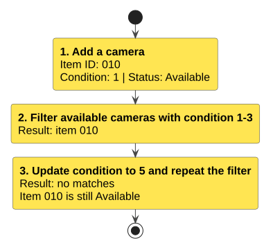

# User Guide

## Introduction

snAp helps photography-club equipment officers track shared gear, maintenance and borrowing through typed commands.
It helps you find available items, avoid double borrowing and retain equipment, maintenance, loan and bundle records between sessions.

**Version:** This guide describes the development build on `master`, including features added after
[v1.0](https://github.com/AY2627S1-CS2113-W13-1/tp/releases/tag/v1.0). The v1.0 JAR does not support every command
below. Use the matching development build for these examples.

## Quick Start

1. Install Java 25 and check that `java -version` reports version 25.
2. Download the [development source ZIP](https://github.com/AY2627S1-CS2113-W13-1/tp/archive/refs/heads/master.zip)
   and extract it. The first Gradle run needs internet access to download build dependencies.
3. Open a terminal in the extracted project folder and run the command for your shell.

   **macOS/Linux:**

   ```sh
   ./gradlew run --console=plain --quiet
   ```

   **Windows PowerShell:**

   ```powershell
   .\gradlew.bat run --console=plain --quiet
   ```

   The plain, quiet console hides Gradle progress messages while keeping application prompts, results and errors.
4. Enter one command per line. Use `help` for the menu and `bye` to save and exit.

To run a packaged build, use `./gradlew shadowJar` on macOS/Linux or `.\gradlew.bat shadowJar` in PowerShell.
This produces `build/libs/snAp.jar`. Copy it to your chosen working folder and run:

```sh
java -jar snAp.jar
```

[Published release downloads](https://github.com/AY2627S1-CS2113-W13-1/tp/releases) contain versioned JARs.
Use the documentation from the same version as the JAR. No internet connection is needed for normal commands
once a build is installed.

## Getting help: `help`

| Format | What it displays | Example |
| --- | --- | --- |
| `help` | The same boxed command menu shown at startup | `help` |
| `help <command>` | The format, example, fields, defaults and restrictions for one command | `help loan` |
| `help all` | The complete command reference | `help all` |

Replace `<command>` with one of these exact lowercase topics:

* Equipment: `add`, `list`, `show`, `delete item`, `filter`, `update`, `maintain`.
* Loans: `loan`, `return`, `delete loan`, `update loan`, `list loans`, `list borrower`, `view loan`, `list overdue`, `history`.
* Bundles: `add-bundle`, `add-to-bundle`, `remove-from-bundle`, `list bundles`, `history bundle`.
* General: `backup`, `restore`, `help`, `bye`.

Include the whole topic for commands with more than one word, for example `help list overdue` or
`help delete loan`. Extra whitespace around or between words is accepted. The group names are menu labels;
they are not help topics. An unknown topic, such as `help loans`, displays an error followed by the compact
menu so that you can choose a supported topic.
`help list member` is an alias for `help list borrower`; both describe the same borrower query.

Help uses `<VALUE>` for a value you must replace and `[field/<VALUE>]` for a field you can omit.
Command details have separate headings, formats, examples and notes, with blank lines between them.
Each command heading has a full-width divider above and below it. In `help all`, two blank lines separate
each command from the previous section.
Help text wraps at 100 columns. A long displayed format or example can span several rows; enter each command
on one line. Unrecognised-command errors point to `help`.

Every help request, including an unknown topic, leaves equipment, loans, bundles, maintenance, availability, identifiers and
saved records unchanged. You can then enter another command normally. Help does not save data or end the session.
If saved data fails to load at startup, only `restore` and `bye` are available until recovery succeeds.

## Optional fields and defaults

In command formats, `<VALUE>` is a value to replace and `[field/<VALUE>]` is an optional field.
Do not type the angle or square brackets. Commands and field prefixes use lowercase spelling.
Defaults apply only when a field is absent. Supplied empty or invalid values produce an error,
except that empty remarks are valid unless damage is `OTHER`.

| Command | Optional field | When omitted |
| --- | --- | --- |
| `add` | Subtype and compatibility details | `unspecified` |
| `add` | `damage/` | `NONE` |
| `add` | `remarks/` | Empty text; rejected if damage is `OTHER` |
| `loan` | `issued/` | Today's date in the application's local time zone, at midnight |
| `return` | `remarks/` | Empty text, replacing previous remarks; rejected if damage is `OTHER` |
| `update` | Name, type or condition | Keep the existing value; supply an ID and at least one field |
| `update loan` | Item, borrower, issue date or due date | Keep the existing value; supply a loan ID and at least one field |
| `filter` | Any individual criterion | No restriction for that criterion; supply at least one criterion |

Equipment name, Item ID, type and numeric condition remain required when adding equipment.
Loans require Item ID, borrower ID and due date. Returns require loan ID, serviceability and damage.
There is no default due date or serviceability decision.

## Equipment worked example

Use a separate working folder with an empty inventory to reproduce these results. Enter these four commands
in order; later reference examples use different Item IDs.

```text
add i/Demo camera id/010 type/camera cond/1
filter type/camera cond/1-3 status/available
update id/010 cond/5
filter type/camera cond/1-3 status/available
```

[](images/EquipmentWorkflow.svg)

The first filter displays item `010`. The update changes its condition to `5`, so the repeated filter prints
`No equipment matches the filters.` Its ID, name and `Available` status stay the same.

## Recording maintenance: `maintain`

Format: `maintain id/<ITEM ID> date/<DD-MM-YY> work/<DESCRIPTION> outcome/<OUTCOME>`

Example: `maintain id/001 date/27-10-26 work/Replaced battery outcome/Completed`

This records completed maintenance work for an existing equipment item. The `ITEM ID` must identify an item in the
current inventory. The date must use `DD-MM-YY` and cannot be later than today's date. Both `DESCRIPTION` and
`OUTCOME` must be non-empty single-line values without tabs. Work descriptions may contain up to 200 characters
and outcomes may contain up to 100 characters after trimming. All four fields are required in the displayed order.
The outcome is free text, not a fixed list of values. Recording maintenance leaves the item's condition,
damage, remarks and serviceability unchanged, so it does not make unserviceable equipment available again.

The record is associated with the physical equipment identity rather than only the visible Item ID. This prevents
maintenance records from being attached to a replacement item if an Item ID is reused later. Records are saved in
`data/maintenance.txt` and are loaded when the application starts again.

Invalid commands, unknown Item IDs, invalid dates and failed saves leave existing maintenance records unchanged.
A successful command shows an `[OK]` label, the Item ID and name, maintenance date, work description and outcome.

## Adding equipment: `add`

Format: `add i/<NAME> id/<ITEM ID> type/<TYPE> cond/<CONDITION> [TYPE DETAIL] [damage/<DAMAGE>] [remarks/<REMARKS>]`

Example: `add i/Canon EOS R10 id/001 type/camera cond/1 remarks/Handle with care`

* `NAME` contains 1 to 100 characters after trimming surrounding whitespace. Whitespace-only names,
  including nonbreaking spaces, are rejected.
* `ITEM ID` uses exactly three digits from `001` to `999` and must not already exist.
* `TYPE` is `camera`, `lens`, `battery` or `tripod`. Type names are case-insensitive and stored in lowercase.
* `CONDITION` is a whole number from `1` to `10`, without leading zeros, signs or decimals.
  Use `1` for pristine and `10` for non-functional as a descriptive rating; the number does not set availability.
* `REMARKS` is free-form text of up to 200 characters. It must remain on one line and is trimmed at both ends.
* Put `remarks/` last when provided. Non-empty remarks are required for `damage/OTHER`.
* Enter the fields in the order shown above. Names can contain spaces.
* Equipment with the same name can be added separately using different IDs.

**Condition and availability are separate:** even an item added with `cond/10` starts as `Available`.
Borrowing is controlled by its [availability status](#equipment-availability), not a numeric threshold.

Success prints `[OK] Equipment <ITEM ID> added.` followed by the item's name, type, condition and status.
The item appears at the end of `list` and is saved automatically.
Adding an existing Item ID does not replace its equipment; use `update` to correct the existing item's details.

For example, with Item ID `001` already present:

| Command | Error |
| --- | --- |
| `add i/Lens id/001 type/lens cond/3` | `Item ID 001 already exists.` |
| `add i/Tripod id/002 type/tripod cond/11` | `Condition must be a whole number from 1 to 10.` |

Rejected additions and failed saves leave the existing equipment unchanged. Correct the input or storage
problem and enter the command again.

After `cond/`, you can add the fields for the equipment type, followed by
`damage/<DAMAGE>`:

| Type | Optional fields, in command order | Damage values |
| --- | --- | --- |
| `camera` | `sensor/<SENSOR FORMAT>`, `mount/<LENS MOUNT>`, `thread/<TRIPOD THREAD>`, `battery/<BATTERY TYPE>` | `NONE`, `SENSOR_DAMAGE`, `SHUTTER_FAULT`, `WATER_DAMAGE`, `BODY_CRACK`, `MISSING_CAP`, `OTHER` |
| `lens` | `zoom/<ZOOM RANGE>`, `mount/<LENS MOUNT>`, `sensor/<SENSOR FORMAT>` | `NONE`, `SCRATCHED_GLASS`, `AUTOFOCUS_FAULT`, `WATER_DAMAGE`, `CRACKED_GLASS`, `MISSING_CAP`, `OTHER` |
| `battery` | `capacity/<CAPACITY>`, `battery/<BATTERY TYPE>` | `NONE`, `SWELLING`, `CONTACT_DAMAGE`, `WATER_DAMAGE`, `LEAKING`, `OTHER` |
| `tripod` | `thread/<TRIPOD THREAD>` | `NONE`, `BENT_LEG`, `HEAD_FAULT`, `WATER_DAMAGE`, `MISSING_PART`, `OTHER` |

* Each type-specific value is free text containing 1 to 100 characters
  on one line.
* Type-specific fields must appear in the order shown in the table.
  `damage/` follows those fields when supplied.
* Optional fields may be omitted independently, except `remarks/` with `damage/OTHER`.
  Omitted compatibility values default to `unspecified`, and damage defaults to `NONE`.
* Damage values are case-insensitive and stored in uppercase. Use a
  damage value from the selected type's row. For `OTHER`, remarks must be non-empty after trimming.
* Fields belonging to another equipment type, invalid damage values,
  repeated fields and fields in the wrong order are rejected.
* Compatibility comparisons ignore letter case.
* `add-to-bundle` checks these attributes against existing bundle members and rejects known mismatches.
  There is no separate command that displays compatibility results.
* Missing comparison data does not block bundle addition. A known conflicting attribute still causes rejection,
  even when another comparison field was omitted. See [Adding equipment to a bundle](#adding-equipment-to-a-bundle-add-to-bundle).
* Compatibility attributes are saved, restored and preserved when the
  equipment name or condition is updated.

Examples:

```text
add i/Canon EOS R10 id/006 type/camera cond/1 sensor/APS-C mount/Canon RF thread/1/4"-20 battery/Li-ion damage/NONE
add i/Standard Zoom id/002 type/lens cond/2 zoom/24-70 mm mount/Canon RF sensor/APS-C damage/NONE
add i/Spare Battery id/003 type/battery cond/3 capacity/2000 mAh battery/Li-ion damage/NONE
add i/Travel Tripod id/004 type/tripod cond/2 thread/1/4"-20 damage/NONE
add i/Backup Camera id/005 type/camera cond/5 damage/OTHER remarks/Damaged control dial
```

### Names and field markers

Names may contain spaces and slashes. A field prefix after whitespace normally starts another field;
`id/card`-like text is an exception when it appears within a name.

| Name fragment | Allowed? | Explanation |
| --- | --- | --- |
| `USB id/card reader` | Yes | The nonnumeric `id/card` fragment stays in the name. |
| `fluid/head tripod` | Yes | A slash within a word does not start a field. |
| `Spare id/001 camera` | No | Numeric ID-like fragments are reserved for the actual Item ID. |
| `Camera type/lens` | No | `type/` starts a type field after whitespace. |

For `add`, the actual `id/` is the last one before `type/`. Earlier ID-like name fragments cannot start
with whitespace, a digit, `+` or `-`. Required fields appear once, in the documented order.
Optional prefixes such as `sensor/` and `remarks/` are recognised only after `cond/`, so
`Camera sensor/cleaning kit` is a valid name. The first `remarks/` after the condition begins the final
literal remarks field. There is no quoting or escaping syntax.

## Viewing equipment: `list`

Format: `list`

Example: `list`

This displays equipment in inventory order using a 96-column table with `ID`, `NAME`, `TYPE`, `CONDITION`
and `STATUS`. Status is `Available`, `Loaned` or `Unserviceable`, using the existing loan and return-assessment
rules. The result count appears below the table.

Names that do not fit end in `...`. Type-specific fields, damage and remarks are available through `show`,
so long values do not expand the table. An empty inventory shows a count of zero and a valid `add` example.
Vertical bars in table values appear as `\u007c` to keep the columns separate. Use `show` to see the original text.

## Viewing full equipment details: `show`

Format: `show id/<ITEM ID>`

Example: `show id/001`

Use an existing three-digit Item ID from `001` to `999`. The command displays the complete name, type, numeric
condition, status, serviceability, active Loan ID, all subtype and compatibility fields, damage and remarks.
Omitted compatibility values appear as `unspecified`; an empty remarks field or absent active Loan ID appears
as `(none)`. Long values wrap onto indented lines at 100 columns and are not truncated.

Tabs and control characters appear as visible escapes, such as `\t`, so that stored text cannot change the
layout. The stored values are preserved. Extra fields, repeated IDs, invalid IDs and unknown items produce a
clear error. Equipment listings, filters and detail requests leave records, identifiers and saved data unchanged.

`show` describes the equipment's current state. Use `view loan/<LOAN ID>` for its condition when a particular
loan was issued, and `list loans` to see borrower IDs and loan dates.

## Deleting equipment: `delete`

Format: `delete item/<ITEM ID>`

Example: `delete item/001`

The item is deleted immediately and a success message is printed. The deleted ID can then be used for another item.

Equipment with an active (unreturned) loan cannot be deleted. This prevents its ID from being reused
for a different item while the original loan is still active. Deletion is allowed once there are no active
loans for that ID; returned loan records do not block deletion.

Equipment that belongs to a bundle cannot be deleted. Use `remove-from-bundle` to remove the item from every
bundle that contains it before deleting the equipment. This keeps each persisted bundle's contents and completion
status consistent with the inventory.

Invalid delete syntax produces an error followed by the delete command format.
An ID that does not exist produces an error without changing the saved records.

## Equipment availability

Check the `STATUS` column in `list` or filter results:

| Status | Meaning | Borrowing again |
| --- | --- | --- |
| `Available` | The item is serviceable and has no active loan. | Create a new loan. |
| `Loaned` | The item already has an active loan. | Return it before creating another loan. |
| `Unserviceable` | The item was returned with `serviceable/no`. | It cannot be borrowed or added to a bundle. |

New items start as `Available`. Use `return` to keep the borrowing history and assess the item:
`serviceable/yes` makes it available again; `serviceable/no` makes it unserviceable. Status is restored
after restarting. Changing an item's name or numeric condition does not change its availability.
Removing an older returned loan does not affect a newer active loan or the item's assessment.

A returned loan cannot be made active again. To borrow the same item again, create a new loan.

## Loaning out equipment: `loan`

Format: `loan id/<ITEM ID> b/<BORROWER ID> [issued/<DD-MM-YY>] due/<DD-MM-YY>`

Example: `loan id/001 b/002 issued/01-10-26 due/08-10-26`

Example with the issue date omitted: `loan id/001 b/002 due/31-12-99`. Replace the due date with the intended
deadline on or after today.

* `ITEM ID` is the three-digit identifier of existing equipment, from `001` to `999`. The item must be `Available`.
* `BORROWER ID` is the three-digit identifier of the borrower, from `000` to `999`.
* `issued/` is optional and defaults to today's date in the application's local time zone, at midnight.
  The date is read once for each command. A supplied issue date overrides this default.
* `due/` is required. Both dates use `DD-MM-YY`. The issue date must not be later than the due date.
  When omitting `issued/`, choose a due date on or after today.
* Keep the displayed field order. Empty, invalid, repeated or misplaced supplied dates are rejected;
  `issued/` without a value does not use the default.
* An item cannot have more than one active loan at the same time.

Each successful loan receives a unique three-digit loan ID. The success message shows this ID, the item ID
and name, borrower ID, issue date and due date, so a separate listing is not needed to confirm the result.
Loan IDs start at `001` and increase through `999`. Deleted IDs are never reused, including after a restart.
Once `999` has been assigned, further new loans are rejected.

Invalid loan commands leave both the loan records and equipment availability unchanged.

## Viewing loans: `list loans`

Format: `list loans`

Example: `list loans`

This displays all recorded loans with these columns: `LOAN ID`, `ITEM ID`, `BORROWER ID`, `ISSUED`, `DUE`
and `STATE`. Dates use `DD-MM-YY`, without a time. `STATE` is `Returned` for returned loans, `Overdue` for
unreturned loans due before today's local date, and `Active` for other unreturned loans. A loan due today is
still `Active`.

Every loan list and item or bundle history uses the same columns and ends with its result count.
For example:

```text
| LOAN ID | ITEM ID | BORROWER ID | ISSUED   | DUE      | STATE    |
| 001     | 001     | 002         | 01-10-26 | 08-10-26 | Returned |
```

An empty list displays `No loans recorded. Type help loan for the command format.` and `0 loans.`.

## Viewing equipment held by a borrower: `list borrower`

Format: `list borrower/<BORROWER ID>`

Example: `list borrower/002`. The equivalent alias `list member/002` is also accepted.

Use exactly three digits from `000` to `999`. The result shows only equipment currently held by that borrower,
with its loan details. Returned loans are excluded. An unknown borrower or one with no active loans produces
a clear message. The query leaves records unchanged.
Dates, states and columns match `list loans`. Results end with a loan count, including `0 loans.` for an empty result.

## Viewing the issue-time equipment condition: `view loan`

Format: `view loan/<LOAN ID>`

Example: `view loan/001`

Use an existing loan ID from `001` to `999`. This displays the equipment type, numeric condition, damage and remarks captured when that loan was issued. The snapshot describes the equipment at issue time, not its current condition.

Later equipment updates and return assessments do not change the saved snapshot. Reassigning an active loan to
another item with `update loan` replaces the snapshot with that item's current assessment. Changing only the borrower
or dates keeps the snapshot. Returned loans retain their snapshots. Older loan records created before this feature
report that the issue condition was not recorded.

This is a read-only command. It does not change equipment, loans, availability or saved records. An invalid command or unknown loan ID produces an error without modifying any data.

## Viewing an item's loan history: `history`

Format: `history id/<ITEM ID>`

Example: `history id/001`

Use an existing Item ID from `001` to `999`. The history includes both active and returned loans for the
equipment currently registered under that ID. Each row shows the loan ID, borrower, issue date, due date and
state, using the same display as `list loans`. Rows are ordered by issue date from earliest to latest,
then by loan ID for equal issue dates.
This command does not change equipment, loans, availability or saved records.

If the item has no recorded loans, the application prints `No loan history for item ID 001.`
If the item does not exist, the application reports the missing ID. Invalid commands show the required format.

Deleting equipment and adding another item under the same Item ID starts a separate history, including when
the replacement has the same name and type. The previous item's loans remain in `list loans`, but are excluded
from the replacement's history. This separation survives restarting and normal equipment updates and returns.

Older saved returned loans may lack enough information to prove which item they belonged to. Such loans remain
in `list loans` and are excluded from item-specific histories. If they use the queried Item ID, the history view
explains this and points to `list loans`. Existing active loans can be associated with the current item when loaded.

## Viewing an equipment summary: `summary`

Format: `summary id/[ITEM ID]`

Example: `summary id/001`

The summary displays exactly one equipment item's permanent identity, name, type, condition, current status,
serviceability, remarks, subtype details and associated loan history. It also includes sections for maintenance,
status and storage-location information when those records exist. When optional information is unavailable, the
summary prints a clear empty-section message instead of failing.

The command is read-only. It does not change equipment, loan records, histories or saved files, and the summary
remains correct after restarting the application. Unknown or invalid Item IDs are rejected.

## Viewing overdue loans: `list overdue`

Format: `list overdue`

Example: `list overdue`

This displays every active loan whose due date is earlier than the current local date. The results show the
same columns, dates, state and count as `list loans`, in the same order as the stored loans.

Returned loans are excluded. A loan due today is not overdue, regardless of its time, and becomes overdue only
on the following date if it remains active. If no loans are overdue, the application displays
`No overdue loans found.`

This is a read-only command. It does not modify loan records, equipment availability or saved files.

## Returning equipment: `return`

Format: `return loan/<LOAN ID> serviceable/<yes|no> damage/<DAMAGE> [remarks/<REMARKS>]`

Examples:

```text
return loan/001 serviceable/yes damage/none remarks/Checked on return
return loan/002 serviceable/no damage/SENSOR_DAMAGE remarks/Sensor needs repair
return loan/003 serviceable/yes damage/none
return loan/004 serviceable/no damage/OTHER remarks/Mounting plate damaged
```

* Use the loan ID from `list loans`, from `001` to `999`. It must identify an active loan.
* `loan/`, `serviceable/` and `damage/` are required, once each and in the displayed order.
  The complete command must be on one line.
* `serviceable/yes` or `serviceable/no` is a mandatory condition assessment. These values are case-insensitive.
  The assessment determines whether the equipment may be borrowed again; damage alone does not decide this.
* `damage/` must use a value from the equipment type's damage table under **Adding equipment**.
  Values are case-insensitive. Use `none` when no damage is found.
* `remarks/` must be last. For `damage/OTHER`, provide non-empty text after trimming.
  For other damage values, omit it or supply empty text to clear previous remarks. Remarks may contain up to 200
  characters after trimming. All text after `remarks/`, including prefix-like text, is treated as remarks.
* The assessment replaces the item's previous damage and remarks. Its name, numeric condition, type-specific
  attributes and existing bundle memberships are retained. The numeric condition can be changed separately with `update`.

A successful return keeps the loan record and its ID, displays its state as `Returned`, and clears its active
equipment link. The success message shows the Loan ID, item ID and name, and the item's resulting `Available`
or `Unserviceable` status.
An already returned loan cannot be returned again or reactivated. Borrowing the same serviceable equipment later
creates a new loan with a new ID. Returning equipment does not consume a loan ID.

Equipment and loan files are saved before the live records change. If a save fails, the application reports the error
and attempts to restore the previous files. The live loan remains active, with its previous equipment assessment.
After fixing the file or directory problem, retry the same command. If restoration also fails, the error explicitly
asks you to check the saved files before retrying.

There is currently no repair command to make unserviceable equipment serviceable again.
Changing its numeric condition with `update` does not remove the unserviceable assessment.

## Deleting a loan: `delete loan`

Format: `delete loan/<LOAN ID>`

Example: `delete loan/001`

Use the loan ID shown by `list loans`, from `001` to `999`. This selects one record even when the same item
has been borrowed more than once. The value is a loan ID, not an equipment ID. Issue-date arguments are no longer
accepted. If no matching loan exists or the command is invalid, the application reports an error and keeps
the existing loan records unchanged.

The deletion is saved before the loan is removed or its equipment is released. If saving fails, the application
reports an error and keeps both the loan records and equipment availability unchanged. You can retry the command
after fixing the storage problem.

Deleting an active loan releases its equipment without changing its serviceability assessment.
Deleting returned loan history leaves any
newer active loan and the equipment's `Loaned` status unchanged.

## Updating loan details: `update loan`

Format: `update loan/<LOAN ID> [id/<ITEM ID>] [b/<BORROWER ID>] [issued/<DD-MM-YY>] [due/<DD-MM-YY>]`

Example:

```text
update loan/001 b/007 due/07-11-26
update loan/001 id/002 b/007 issued/03-10-26 due/07-11-26
```

Use the unique loan ID shown by `list loans`. Supply at least one field to update, in any order, once each.
The loan ID remains unchanged, and omitted fields retain their current values. The supported fields are:

* `id/` changes the equipment assigned to the active loan. The replacement must exist, be serviceable and have
  no active loan. The previous item is released, and the snapshot is replaced with the replacement item's current
  assessment. Supplying the current Item ID keeps the existing assignment and snapshot.
* `b/` changes the three-digit borrower ID.
* `issued/` changes the issue date.
* `due/` changes the due date.

The effective issue date must not be later than the effective due date. Unknown loan IDs, malformed IDs or dates,
duplicate fields, unavailable equipment and returned loans are rejected. This project stores borrower IDs rather than
borrower profiles, so borrower validation is limited to the documented three-digit identifier format.

The complete proposed loan list is saved before the live loan and equipment associations change. If validation or
saving fails, the original loan, equipment availability and saved file remain unchanged. Successful edits remain after
restarting the application.

## Filtering equipment: `filter`

Format: `filter [id/<ITEM ID>] [i/<NAME>] [type/<TYPE>] [cond/<CONDITION>] [status/<STATUS>]`

Examples:

* `filter type/camera cond/1-3 status/available`
* `filter i/canon`
* `filter id/001`
* `filter status/loaned`

Supply at least one filter, in any order. Each prefix can appear only once, and every supplied criterion must match.
For example, the first command above finds cameras that are both available and within condition `1` to `3`.

| Field | Matching rule |
| --- | --- |
| `id/` | Exact three-digit Item ID from `001` to `999`. |
| `i/` | Part of the name, ignoring case; spaces are allowed. |
| `type/` | Full type name, ignoring case: `camera`, `lens`, `battery` or `tripod`. |
| `cond/` | One value from `1` to `10`, or an inclusive range such as `1-3`. |
| `status/` | `available` or `loaned`, ignoring case. |

Condition ranges must be ascending. Values such as `3-1`, `01` or `2.5` are rejected.
`available` excludes active loans and unserviceable items; returned loans do not block availability.
There is no `status/unserviceable` filter. To see those items, use `list` or omit the status criterion.
An unrecognised type, such as `type/microphone`, produces no matches.

The [name and field-marker rules](#names-and-field-markers) also apply here. Empty or repeated fields are rejected. Filtering leaves equipment
unchanged and prints matches in inventory order, or `No equipment matches the filters.` when none match.
Matching rows use the same compact columns and truncation rules as `list`, followed by a result count.
Use `show id/<ITEM ID>` for full values. A filter with no matches shows a count of zero and a clear message.
An invalid filter also leaves equipment and loan records unchanged; correct the filter and try again.
See the [worked example](#equipment-worked-example) for a query with known results.

## Updating equipment: `update`

Format: `update id/<ITEM ID> [i/<NAME>] [type/<TYPE>] [cond/<CONDITION>]`

Examples:

* `update id/001 cond/5`
* `update id/001 i/Film Camera cond/5`

Supply an existing ID and at least one of `i/`, `type/`, or `cond/`. Fields may appear in any order, once each.
The ID stays fixed and omitted details keep their current values. Names contain 1-100 characters after trimming;
whitespace-only names are rejected. Conditions are whole numbers from `1` to `10`, without leading zeros,
signs or decimals. Condition ranges are accepted by `filter` only.

Equipment types cannot be changed. If supplied, `type/` checks the existing type and must match it,
ignoring case. A matching `type/` on its own is accepted without changing any details.
Updates keep the item in its current list position and retain its subtype details, damage, remarks,
availability, loan history and bundle memberships. These other details cannot be edited with `update`.

Success prints `[OK] Equipment 001 updated.` for Item ID `001`, followed by the item's name, type, condition and
status, and saves the changes.
With `001` registered as a camera, these commands are rejected:

| Command | Error |
| --- | --- |
| `update id/001 i/Film Camera cond/11` | `Condition must be a whole number from 1 to 10.` |
| `update id/001 type/lens` | `Equipment type cannot be changed. Item ID 001 must remain camera.` |

The [name and field-marker rules](#names-and-field-markers) apply. `status/` cannot be updated manually.
Invalid commands or failed saves leave all existing details unchanged. In the first rejected example,
neither the name nor condition changes. An ID that does not exist is rejected rather than creating equipment.
Correct the command or storage problem and try again.

## Creating a bundle: `add-bundle`

Format: `add-bundle name/<NAME>`

Example: `add-bundle name/Travel Kit`

The name must contain 1 to 100 characters and must be unique. Names are compared case-sensitively,
so `Travel Kit` and `travel kit` are different names. A bundle starts empty and incomplete. The application assigns
three-digit bundle IDs in creation order, starting at `001`, with at most 999 bundles in the saved collection.
Bundle IDs are separate from equipment IDs.

Bundles and their equipment memberships are saved when you enter `bye` and restored when the application
restarts. Bundle IDs continue from the highest restored ID. Equipment and loans remain saved separately.

## Adding equipment to a bundle: `add-to-bundle`

Format: `add-to-bundle id/<BUNDLE ID> <EQUIPMENT ID> [<EQUIPMENT ID> ...]`

Example: `add-to-bundle id/001 001 002 003`

The bundle must exist. Supply one or more equipment IDs, separated by spaces. Each requested item gets
its own success or error message. Valid items are added even if another requested item is rejected.
Successful results include the equipment name. A mixed request shows `[OK]` or `[ERROR]` for each item,
then totals such as `2 memberships added; 1 failed.` and the resulting bundle composition.

* Equipment must exist in the inventory and be `Available` when added.
* An item cannot appear twice in the same bundle. It can appear in different bundles.
* A bundle can contain only one camera and at most one tripod. Extra batteries and lenses are allowed.
* Each item is compared with equipment already accepted into the bundle, including items accepted earlier
  in the same command.
* A known compatibility mismatch rejects only that item. Compatibility comparisons ignore letter case.
* Missing compatibility details and equipment pairs without shared compatibility fields do not block addition.
* A bundle is complete when it contains exactly one camera, at least one battery and at least one lens.
  A tripod is optional.

The following fields are compared:

| Equipment pair | Fields that must match when known |
| --- | --- |
| Camera and lens | Lens mount and sensor format |
| Camera and battery | Battery type |
| Camera and tripod | Tripod thread |

For a camera and lens, a known mismatch in either field causes rejection, even if the other field is missing.
Lens-battery, lens-tripod, battery-tripod and same-type pairs do not fail the compatibility check.
The limits of one camera and one tripod still apply.

Returning a serviceable item or deleting its active loan makes it available for a later `add-to-bundle` command.
Unserviceable equipment cannot be added to a bundle. Existing bundle memberships are retained on return.
Updating a bundled item's name or condition also updates the item shown in the bundle.

## Removing equipment from a bundle: `remove-from-bundle`

Format: `remove-from-bundle id/<BUNDLE ID> <EQUIPMENT ID> [<EQUIPMENT ID> ...]`

Example: `remove-from-bundle id/001 001`

The bundle must exist. Each requested equipment ID is removed independently, and an equipment item can be
deleted only after it has been removed from every bundle that contains it. Successful membership removals are
saved immediately; a save failure restores the previous membership.

## Viewing bundles: `list bundles`

Format: `list bundles`

Example: `list bundles`

This displays each bundle's ID, full name, contained equipment and member count, followed by the total bundle
count. `Composition: Complete` means the existing equipment-count requirements are met. An incomplete bundle
names its missing required types, for example `Incomplete (missing lens, battery)`.
These descriptions concern composition; they do not promise equipment compatibility or availability.
Borrowing an item later does not remove it from its bundle.

An empty list suggests `add-bundle name/Camera kit` and displays `0 bundles.`. The display reminds you to save
new bundles and additions with `bye`; successful removals are saved immediately. Saved bundles are restored
at startup.

## Viewing a bundle's loan history: `history bundle`

Format: `history bundle/id/<BUNDLE ID>` or `history bundle/name/<NAME>`

Examples: `history bundle/id/001` and `history bundle/name/Travel Kit`

Select a bundle by ID, or by its exact case-sensitive name. If several bundles share that name, use the ID.
This displays all active and returned loans for every physical equipment item currently in the selected bundle,
including loans issued before the item joined. Removing an item removes its loans from this bundle's history view.
Results are ordered by issue date from earliest to latest, then by loan ID. An empty history and an unknown
bundle are reported clearly. Bundle memberships are matched using each equipment record's permanent identity,
so a reused visible Item ID cannot inherit the wrong historical membership.
Dates, states, columns and result counts use the same format as `list loans` and item histories.

## Saving application data

Successful equipment additions, updates, deletions and return assessments are saved automatically in
`data/equipment.txt`, relative to the directory from which the application is run.
Successful loan additions, updates, returns and deletions are saved in
`data/loans.txt`, the next unused loan ID is saved in `data/loan-sequence.txt`, and bundle memberships are saved
in `data/bundles.txt`. Records are loaded when the application starts again. A final save is also attempted when
`bye` is entered; if it fails, the application reports the affected file and lets you retry.
The data directory and the equipment, loan, sequence and maintenance files are created when they are first saved,
including during the final save performed by `bye`. `bundles.txt` is created when bundle data is first saved and may
be absent if no bundles have been created.
Each item's availability and associated loan ID are rebuilt from active loans at startup, so loaned items
remain `Loaned` after restarting the application.

The text file contains one equipment record per line, using the add command format. For example:

```text
add i/Canon EOS R10 id/001 type/camera cond/1
add i/Travel tripod id/003 type/tripod cond/2 thread/1/4 inch damage/NONE
add i/Canon EOS R10 id/004 type/camera cond/1 remarks/Handle with care
```

Saved equipment records use the four supported types and retain their type-specific values and damage.
Existing records of supported types without optional fields are also accepted, using `unspecified` and `NONE`.
Records created before remarks were supported may omit the `remarks/` field; they load with empty remarks.
Records with `damage/OTHER` require non-empty remarks; invalid saved records are reported when loaded.
Remarks are shown by `show id/<ITEM ID>` and are restored when the application starts again.
Saved records may start with `serviceable/yes` or `serviceable/no`, followed by a tab and the add record.
This prefix is storage metadata, not an add-command field. Older records without the prefix are serviceable.
New records also start with `recordId/` and a permanent equipment identifier, followed by a tab before
the serviceability prefix. The application assigns this identifier; it is separate from the reusable Item ID.
Older equipment records are upgraded and saved with permanent identifiers when first loaded. If that save fails,
startup reports the error instead of using identifiers that could change on the next restart.

Loan records include the loan ID, item ID, borrower ID, issue date, due date and returned status. For example:

```text
loan loanId/001 id/001 b/002 issued/01-10-26 due/08-10-26 returned/false
```

Saved loans always contain explicit issue and due dates, including a default issue date chosen by a command.
Loading a saved record never substitutes today's date for a missing or malformed date.

New loan records also end with `equipment/` and the permanent identifier of the borrowed equipment.
Returns retain this identifier, so later reuse of the Item ID cannot mix histories. Older returned records without
it are kept without assigning them to the current item. Older active records receive the current item's identifier
and are saved before the application uses their associations.

Existing loan records without loan IDs are assigned IDs in file order on first load and saved in the new format.
These IDs remain stable on later restarts. The sequence file preserves the next unused ID even when loan records
are deleted. Equipment records retain their details and remarks; loan associations are restored from the loan records.

To transfer your records, save with `bye`, then copy `data/equipment.txt`, `data/loans.txt`,
`data/loan-sequence.txt` and `data/maintenance.txt` to the same location on the other computer. Copy
`data/bundles.txt` as well when bundles have been created. If a file cannot be read
or contains invalid or duplicate records, the application reports the problem and accepts only `restore` or `bye`.
Use `restore` to recover from a valid backup, or `bye` to exit before correcting the saved files. In this state,
`bye` exits without saving over the damaged files.

## Backing up and restoring records

Format: `backup path/<DIRECTORY>`

Example: `backup path/backups/session-1`

The `backup` command creates a new directory containing saved `equipment.txt`, `loans.txt`, `loan-sequence.txt` and a
checksum manifest. It does not save unsaved changes or include bundles and maintenance. The destination must be outside the live
data directory and must not already exist, so an existing backup cannot be silently overwritten. Empty equipment and
loan records are represented by valid empty files, while the sequence file records the next available loan ID.
Backup creation leaves live records unchanged. Supply one non-empty path; relative paths use the application's
working folder, and paths may contain spaces. Do not add quotation marks around a path entered at the snAp prompt.

Format: `restore path/<DIRECTORY>`

Example: `restore path/backups/session-1`

The `restore` command verifies the manifest and loads all three records in an isolated temporary location before
replacing the live files. Equipment, loans and the loan sequence are restored together; active loans mark their
equipment as `Loaned`, returned loans remain in history, and the next loan ID is preserved. If the backup is missing,
tampered with, malformed, incomplete, duplicated or inconsistent, the restore is rejected and the current live files
and in-memory state remain unchanged. Successful restores clear all current bundles and saved bundle memberships
because bundles are not included in the backup. Maintenance records are left unchanged.

`restore` is also available after a startup loading error. A valid equipment-and-loan backup can repair those records.
It does not repair or reload maintenance. If startup reports damaged maintenance data, exit with `bye`, preserve a
copy of the damaged file, and repair or recover `data/maintenance.txt` separately before restarting.

## Diagnostic logs

Diagnostics use up to two rotating files, `logs/snap.log.0` and `logs/snap.log.1`, relative to the launch folder.
Each file is limited to approximately 1 MB; older records are replaced as the logs rotate. Logs are retained
between runs. If file logging reports `Warning: Application logging is unavailable: ...`, commands can still
be used. Close snAp, check that `logs` is a writable folder rather than a regular file, fix the folder or
permission problem, then restart snAp. File logging is configured only at startup.

## Errors

Successful changes start with `[OK]`; rejected commands and save failures start with `[ERROR]`.

* Empty or unknown commands show an error and direct you to `help`. You can then enter another command.
* Invalid add or delete commands show the correct syntax. Invalid fields, duplicate IDs and missing IDs are rejected.
* File errors show the reason and ask you to check the file or directory permissions.
* Saves are written to temporary files before replacing the saved records, preserving previous records if writing fails.
* Command validation errors show an `[ERROR]` message and let you enter another command at the command prompt.
* If saved records cannot be loaded, only `restore` and `bye` are available. `bye` exits without saving in this state.
  The application stops if console input is no longer available.

## Command Summary

| Action | Command |
| --- | --- |
| Show the compact command menu | `help` |
| Show one command's format, example and defaults | `help <command>` |
| Show the complete command reference | `help all` |
| Add equipment | `add i/<NAME> id/<ITEM ID> type/<TYPE> cond/<CONDITION>` with optional details, damage and remarks |
| Delete equipment | `delete item/<ITEM ID>` |
| Add loan | `loan id/<ITEM ID> b/<BORROWER ID> [issued/<DD-MM-YY>] due/<DD-MM-YY>` |
| Return equipment | `return loan/<LOAN ID> serviceable/<VALUE> damage/<DAMAGE> [remarks/<REMARKS>]` |
| Delete loan | `delete loan/<LOAN ID>` |
| Update loan | `update loan/<LOAN ID> [id/<ITEM ID>] [b/<BORROWER ID>] [issued/<DD-MM-YY>] [due/<DD-MM-YY>]` |
| List equipment | `list` |
| Show full equipment details | `show id/<ITEM ID>` |
| List loans | `list loans` |
| View issue-time equipment condition | `view loan/[LOAN ID]` |
| View item loan history | `history id/[ITEM ID]` |
| View bundle loan history | `history bundle/id/[BUNDLE ID]` or `history bundle/name/[NAME]` |
| View equipment summary | `summary id/[ITEM ID]` |
| View a borrower's current equipment | `list borrower/<BORROWER ID>` (alias `list member/<BORROWER ID>`) |
| View issue-time equipment condition | `view loan/<LOAN ID>` |
| Back up equipment and loan records | `backup path/<DIRECTORY>` |
| Restore equipment and loan records | `restore path/<DIRECTORY>` |
| View item loan history | `history id/<ITEM ID>` |
| View bundle loan history | `history bundle/id/<BUNDLE ID>` or `history bundle/name/<NAME>` |
| Record maintenance work | `maintain id/<ITEM ID> date/<DD-MM-YY> work/<DESCRIPTION> outcome/<OUTCOME>` |
| List overdue loans | `list overdue` |
| Filter equipment | `filter [id/<ITEM ID>] [i/<NAME>] [type/<TYPE>] [cond/<CONDITION>] [status/<STATUS>]` |
| Update equipment | `update id/<ITEM ID> [i/<NAME>] [type/<TYPE>] [cond/<CONDITION>]` |
| Create bundle | `add-bundle name/<NAME>` |
| Add equipment to bundle | `add-to-bundle id/<BUNDLE ID> <EQUIPMENT ID> [<EQUIPMENT ID> ...]` |
| Remove equipment from bundle | `remove-from-bundle id/<BUNDLE ID> <EQUIPMENT ID> [<EQUIPMENT ID> ...]` |
| List bundles | `list bundles` |
| Exit | `bye` |
